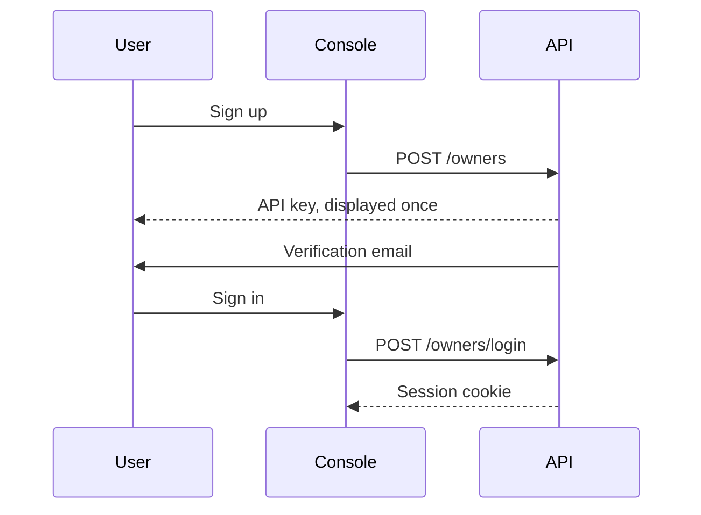

An account is an **owner**. The email address is the username. `is_active` indicates that the email address has been verified.

Registration and authentication are separate operations. Scripts authenticate with an API key; the console authenticates with a session cookie. Neither credential is stored in the browser for manual reuse.

<Callout type="warn" title="The API key is displayed once">
The database stores only a SHA-256 hash of the key, so the key cannot be displayed again. Rotating the key invalidates the previous one. If the key is lost, a new one must be generated.
</Callout>

## Registration

`POST /owners` creates the account and returns an API key once. The console registration form is available at `/signup`.

When the instance requires acceptance of terms, registration also asks for acceptance of the terms of use and the privacy policy. Account terms do not expire; acceptance is requested again only when the text changes. On instances that do not require acceptance, this step is omitted, `GET /terms` returns 404, and the console hides the corresponding checkboxes.

An account cannot pass the standard access checks until its email address is verified. The verification link calls `GET /owners/verify-email`. A new verification message can be requested with `POST /owners/me/resend-verification`.

## Authentication

The console authenticates with a session cookie, using `POST /owners/login` and `POST /owners/logout`. Unverified owners can sign in in order to complete verification. Sign-in attempts are rate-limited per client IP address and per email address. Failed attempts expire after a period of time and do not accumulate indefinitely.

The readings API accepts the same session cookie as the registry API.

Scripts authenticate with the `Authorization: Bearer` header and the API key. The key is rotated with `POST /owners/me/rotate-key`, and the new key is displayed once.

A password reset uses a token sent in the request body: `POST /owners/request-password-reset`, followed by `POST /owners/reset-password`. A signed-in owner changes the password with `POST /owners/me/change-password`.

## Roles

| Role | Assignment | Additional permissions |
| --- | --- | --- |
| Member | Registration | Owned meshes, devices, and blueprints |
| Operator | Approval of a request by a superuser | Sources, sinks, and the archive |
| Staff | Assigned by the instance administrator | Read access to the catalogue, without secrets or write access |
| Superuser | Assigned by the instance administrator | Access to every mesh and every key |

The operator role is requested from **Profile** with **Request operator role**. Each owner may have one pending request at a time. A rejected request may be submitted again. Once a request is approved, the owner's `role` becomes `operator`.

## Visibility

A verified owner can read their own meshes and any mesh marked as public. A superuser can read every mesh. The public flag never grants write access.

Staff can read the catalogue but cannot view PSKs. Operators can view only the sources and sinks they created; superusers can view all of them.

## Alarm notifications

`alarm_email_cooldown_seconds` on `PUT /owners/me` overrides the instance default for the period during which alarms on a device are held before a summary email is sent. A null value applies the instance default. See [Quality and alarms](/quality).

Two further settings concern infrastructure created by the owner rather than sensor alarms:

- `status_alerts_enabled` sends an email when a source or sink created by the owner remains disconnected or unused.
- `source_rate_alerts_enabled` sends an email when a source created by the owner remains above the message rate allowed by the instance.
