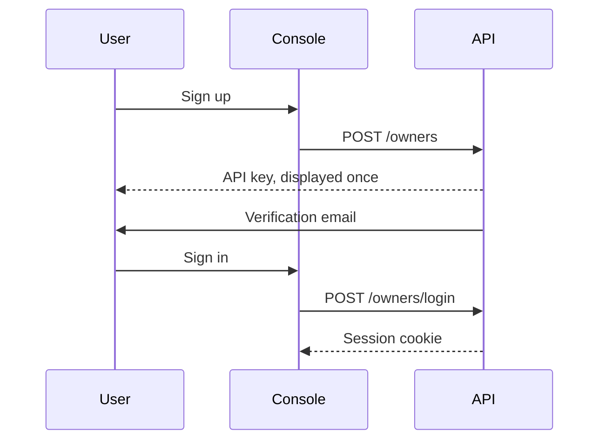

An account is an **owner**. The email address is the username. `is_active` is true once that address is verified.

The console signs in with a session cookie. Scripts send an API key. The key is shown once and is not kept in the browser.

<Callout type="warn" title="The API key is displayed once">
The database stores only a SHA-256 hash of the key, so the key cannot be displayed again. Rotating the key invalidates the previous one. If the key is lost, generate a new one.
</Callout>

## Registration

`POST /owners` creates the account and returns an API key once. The console form is at `/signup`.

When the instance requires terms, registration also asks you to accept the terms of use and the privacy policy. Account terms do not expire. Acceptance is asked again only when the text changes. On an instance that does not require acceptance, this step is skipped, `GET /terms` returns 404, and the console hides the checkboxes.

An account cannot pass the usual access checks until the email is verified. The link in the message calls `GET /owners/verify-email`. Ask for another message with `POST /owners/me/resend-verification`.

## Authentication

The console uses a session cookie: `POST /owners/login` and `POST /owners/logout`. An unverified owner can sign in to finish verification. Sign-in is limited for each pair of client IP and email. The limit is a time window, so old failures drop out.

The readings API accepts the same session cookie as the registry API.

Scripts send `Authorization: Bearer` and the API key. Rotate the key with `POST /owners/me/rotate-key`. The new key is displayed once.

A password reset uses a token in the request body: `POST /owners/request-password-reset`, then `POST /owners/reset-password`. A signed-in owner changes the password with `POST /owners/me/change-password`.

## Roles

| Role | Assignment | Additional permissions |
| --- | --- | --- |
| Member | Registration | Owned meshes, devices, and blueprints |
| Operator | A superuser approves the request | Sources, sinks, and the archive |
| Staff | Assigned by the instance administrator | Read access to the catalogue, without secrets or write access |
| Superuser | Assigned by the instance administrator | Every mesh and every key |

Request the operator role from **Profile** with **Request operator role**. An owner can have one pending request. A rejected request can be sent again. When it is approved, `role` becomes `operator`.

## Visibility

A verified owner can read their own meshes and any mesh marked public. A superuser can read every mesh. The public flag never grants write access.

Staff can read the catalogue but cannot view PSKs. An operator can view only the sources and sinks they created. A superuser can view all of them.

## Alarm notifications

`alarm_email_cooldown_seconds` on `PUT /owners/me` replaces the instance default for how long alarms on a device are held before a summary email is sent. Null uses the instance default. See [Quality and alarms](/quality).

Two further settings are about infrastructure, not sensor alarms:

- `status_alerts_enabled` sends an email when a source or sink the owner created stays disconnected or unused, or when a device on a mesh the owner has runs a newer protocol than the mesh declares. Every owner can turn it on.
- `source_rate_alerts_enabled` sends an email when a source the owner created stays above the message rate the instance allows.
