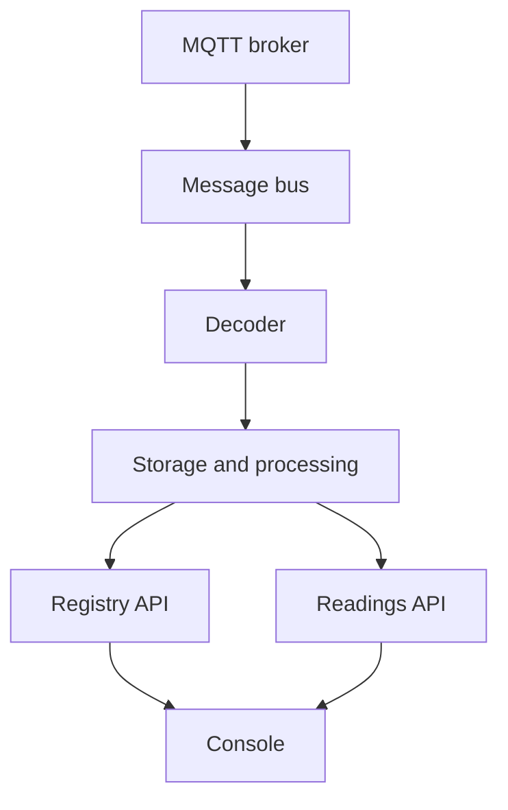

The platform consists of an ingestion pipeline, two HTTP APIs, and the console. The pipeline receives packets from MQTT, decodes them, and writes the results to the data stores. The APIs serve those stores, and the console is built on the APIs.

## Ingestion

An MQTT bridge copies traffic from the instance's broker, and from any registered [sources](/docs/sources), onto an internal message bus as raw packets. The bus decouples ingestion from decoding, so that a temporary interruption downstream does not lose packets.

## Decoding

The decoder reads raw packets and looks up the mesh key by gateway. Packets from an unknown gateway or a rejected node are discarded. Allowed packets are decrypted and converted to structured events containing the mesh identifier, the node identifier, the payload type, and the payload.

Depending on the instance, decoding runs either as a lightweight service or as a stream processing job. Stream processing also applies calibration and the stream detectors described in [Quality and alarms](/docs/quality).

## Storage and processing

Decoded events are consumed by several independent components:

- a writer that stores readings in InfluxDB
- registry consumers that record device sightings and discover sensor channels
- an archive writer that stores Parquet files for devices that opt in
- the detectors and scheduled jobs that produce quality metrics, derived channels, and alarms

See [Data stores](/docs/data) for the contents of each store.

## APIs

Two HTTP APIs share a single public entry point:

- The **registry API** manages accounts, meshes, devices, the catalogue, blueprints, sources, and sinks. It is backed by PostgreSQL.
- The **readings API** serves series, latest values, traffic statistics, exports, and the archive. It is backed by InfluxDB.

Requests under `/readings/` are routed to the readings API, and all other requests to the registry API. The OpenAPI document is available at `/schema`. The readings API has no access to mesh keys.
