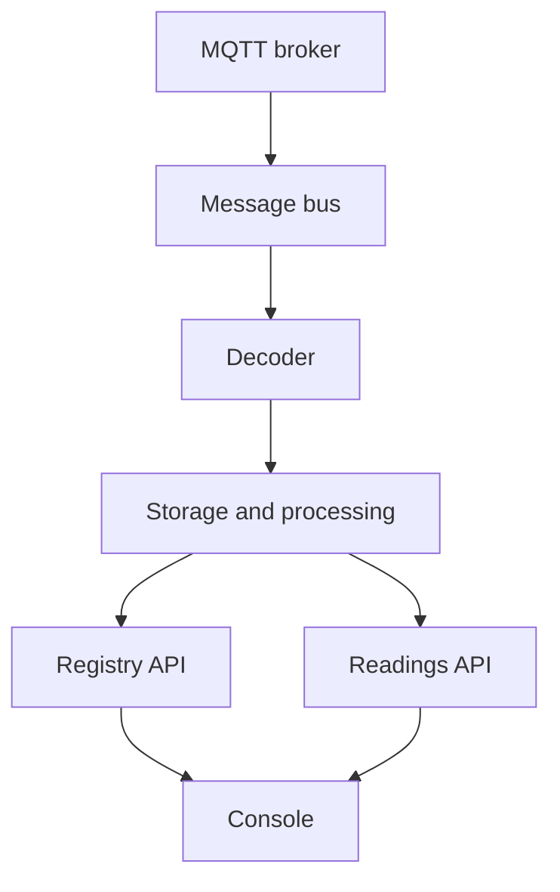

The platform is an ingestion pipeline, two HTTP APIs, and the console. The pipeline takes packets from MQTT, decodes them, and writes the results to the data stores. The APIs serve those stores. The console is built on the APIs.

## Ingestion

An MQTT bridge copies traffic from this instance's broker, and from any registered [sources](/sources), onto an internal message bus as raw packets. The bus separates ingestion from decoding, so a short stop downstream does not drop packets.

## Decoding

The decoder reads raw packets and looks up the mesh key by gateway. Packets from an unknown gateway or a rejected node are discarded. Allowed packets are decrypted and turned into structured events: mesh identifier, node identifier, payload type, and payload.

On some instances decoding runs as a lightweight service. On others it runs as a stream processing job. Stream processing also applies calibration and the stream detectors described in [Quality and alarms](/quality).

## Storage and processing

Several independent components consume the decoded events:

- a writer that stores readings in InfluxDB
- registry consumers that record device sightings and discover sensor channels
- an archive writer that stores Parquet files for devices that opt in
- the detectors and scheduled jobs that produce quality metrics, derived channels, and alarms

See [Data stores](/data) for what each store holds.

## APIs

Two HTTP APIs share one public entry point:

- The **registry API** manages accounts, meshes, devices, the catalogue, blueprints, sources, and sinks. It uses PostgreSQL.
- The **readings API** serves series, latest values, traffic statistics, exports, and the archive. It uses InfluxDB.

Requests under `/readings/` go to the readings API. Every other request goes to the registry API. The OpenAPI document is at `/schema`. The readings API has no access to mesh keys.
