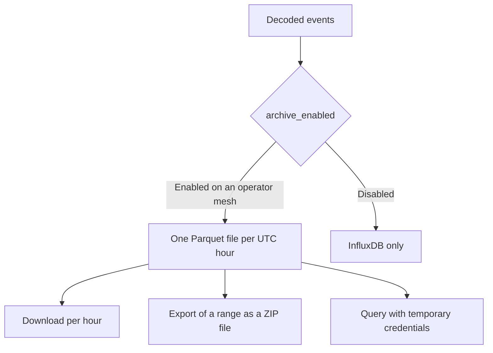

The archive is a long-term copy of decoded events, stored as Parquet files in S3-compatible object storage. It is disabled unless a device opts in. Console charts continue to read from InfluxDB.

The archive and the charts are independent. Disabling the archive for a device stops the creation of new files and retains the files already written.

<Callout type="info" title="Availability">
The archive is available only on instances configured with object storage. On other instances, the archive list returns 404 and the console indicates that the feature is unavailable.
</Callout>

## Eligibility

`archive_enabled` is accepted only when the mesh owner is an operator and the instance provides an archive. The owner and superusers can view the setting; staff and public readers cannot.

The console labels the setting **S3 storage**, in the device inventory, in the variant tables, and in the latest-value menu. **Archive** refers to the page, not to retiring a device. Disabling the setting stops the creation of new files and retains the existing ones. The device records who changed the setting and when, and an append-only history keeps every change.

## Files

The archive contains one object per mesh and UTC hour:

`{prefix}/mesh_id={uuid}/dt={YYYY-MM-DD}/hour={HH}/data.parquet`

**Data → Archive** (`/console/archive`) lists the user's meshes with their number of devices, number of files, total size, and latest hour. A superuser also sees meshes owned by other users that contain archived data. The detail page of a mesh shows which devices are included, followed by the files: one row per UTC day, newest first, each expanding to one download per hour.

Each hourly download redirects to the object. A whole day, or a longer range, is exported as a job with `format: parquet`: a ZIP file with one folder per day, containing `YYYY-MM-DD/YYYY-MM-DD_HH.parquet`. The limits that apply to CSV exports also apply here: a maximum range of 366 days, one export at a time, and a link valid for 24 hours. See [Readings](/docs/readings).

## Direct queries

The archive page can issue temporary credentials, which are displayed once and cannot be revoked before they expire. With those credentials, the page provides either:

- a DuckDB `COPY` statement that combines the files into a single Parquet file, or
- an `aws s3 sync` command that copies the hourly folders unchanged

When the instance does not support temporary credentials, the credential endpoint returns 404 and the page offers the per-file downloads instead. The DuckDB statement uses path-style addressing and configures `USE_SSL` according to the endpoint.
