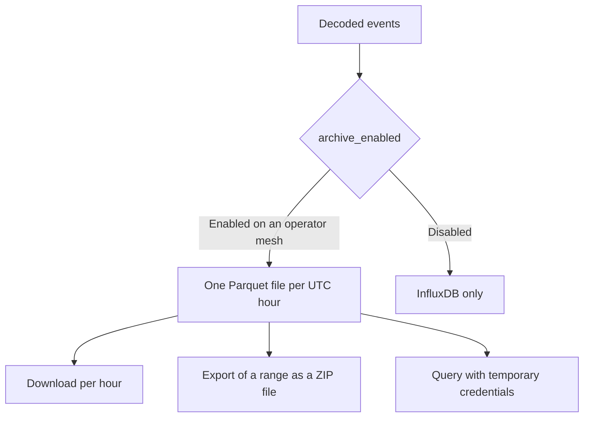

The archive is a long-term copy of decoded events, stored as Parquet in S3-compatible object storage. A device is left out until `archive_enabled` is turned on. Console charts keep reading from InfluxDB.

The archive and the charts are separate. Turning the archive off for a device stops new data for that device and keeps the files already written.

<Callout type="info" title="Availability">
The archive runs only on instances configured with object storage. On other instances the archive list returns 404, and the console says the feature is unavailable.
</Callout>

## Eligibility

`archive_enabled` is accepted only when the mesh owner is an operator and the instance runs the archive. The owner and superusers can see the setting. Staff and public readers cannot.

The console calls the setting **S3 storage**, in the device inventory, in the variant tables, and in the latest-value menu. **Archive** is the page, not a way to retire a device. Turning the setting off stops new files for that device and keeps the existing ones. The device records who changed the setting and when. An append-only history keeps every change, including after the device is deleted.

## Files

There is one object per mesh and UTC hour, holding the devices that had the archive on:

`{prefix}/mesh_id={uuid}/dt={YYYY-MM-DD}/hour={HH}/data.parquet`

**Data → Archive** (`/console/archive`) lists the user's meshes with device count, file count, total size, and latest hour. A superuser also sees other owners' meshes that contain archived data. A mesh detail page shows which devices are included, then the files: one row per UTC day, newest first. Each row opens into one download per hour. The API lists hours oldest first. The page groups them newest first.

Each hourly download redirects to the object. A whole day, or a longer range, is an export job with `format: parquet`: a ZIP with one folder per day, named `YYYY-MM-DD/YYYY-MM-DD_HH.parquet`. The same limits as CSV exports apply: at most 366 days, one export queued or running per owner, and a link that lasts 24 hours. See [Readings](/readings).

## Direct queries

The archive page can issue temporary credentials. They are shown once and cannot be revoked before they expire. They stay valid until `expires_at`, even if the caller later loses access to the mesh. With those credentials the page offers either:

- a DuckDB `COPY` statement that combines the files into one Parquet file, or
- an `aws s3 sync` command that copies the hourly folders unchanged

When the instance cannot issue temporary credentials, the credential endpoint returns 404 and the page offers the per-file downloads. For an endpoint other than AWS, the DuckDB statement uses path-style addressing. It sets `USE_SSL false` when the endpoint is `http://`.
