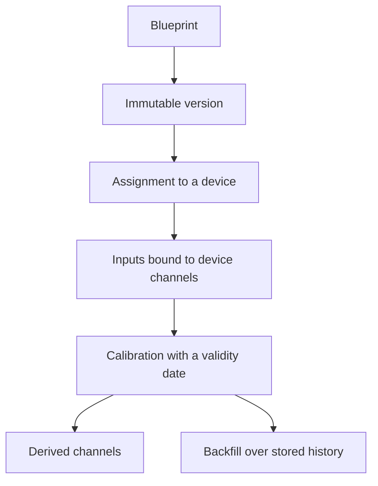

A blueprint is an ordered list of named algorithms from `GET /algorithms`. Owners edit blueprints under **Automation → Blueprints** (`/console/blueprints`). Each owner can view their own blueprints and every public blueprint.

Blueprints and device assignments are versioned apart. Editing a blueprint does not change devices that already run it.

<Callout type="info" title="Calibration belongs to the device">
The blueprint names the algorithm. The device stores the calibration values with `valid_from`. Reprocessing history uses the calibration that was in force at each sample.
</Callout>

## Versioning

A change to the name, the description, or the public flag updates the blueprint in place. A change to the steps creates a **new version**, copied from the latest one. A device is assigned to one version, so the formula on a running device changes only when you update that assignment.

Each step has:

- a key and a position, both unique within the version
- `function_name`, which must exist in the algorithm catalogue
- `inputs`: each algorithm input is `slot:<name>` or `step:<key>.<output>`
- `params` for configuration. Parameters marked as calibration are not set here.
- `outputs`: each algorithm output becomes a derived field name

Renaming a slot or a step updates every reference to it. The console checks the same rules as the API before the form is submitted.

## Device assignment

On the device page, a postprocessing assigns one blueprint version to the device:

- each input slot is bound to a channel of the device
- `output_prefix` is prepended to every derived field, so the same blueprint can run more than once on a device
- `tolerance_seconds` is the longest gap between samples treated as simultaneous. Null uses half the device's reading interval, or 30 seconds when the device has no interval.
- `is_enabled` starts and stops the postprocessing

Derived channels are measurements whose `produced_by` field points at the postprocessing. When the last channel that uses a derived catalogue type is deleted, that type is deleted too, so an old unit does not block a later assignment.

## Calibration

Calibration is stored on the device, not on the blueprint. `StepCalibration` rows are append-only. Each row has a step key, the algorithm name, the parameters, and `valid_from`. Reprocessing history applies the calibration in force at each sample. A calibration applies only while the step still uses that algorithm.

If a step fails on a reading, the error is recorded and that reading produces no derived value.

## Backfill

A backfill (`POST` on the postprocessing) runs the blueprint again over stored readings. `stop` defaults to now. The span is at most 90 days. The postprocessing must be valid. It does not have to be enabled. `include_dependants` also reruns, in dependency order, the enabled postprocessings that read this one's outputs. Status moves through `pending`, `running`, `done`, and `failed`. The record keeps the number of points published. Backfilled values are stored. They do not raise alarms.

A backfill loads the channels for the range, joins samples within `tolerance_seconds`, runs the steps in order, and writes the `derived` measurement, tagged with the postprocessing. Pointwise algorithms can also run on each incoming sample. Windowed algorithms run only as scheduled jobs.
