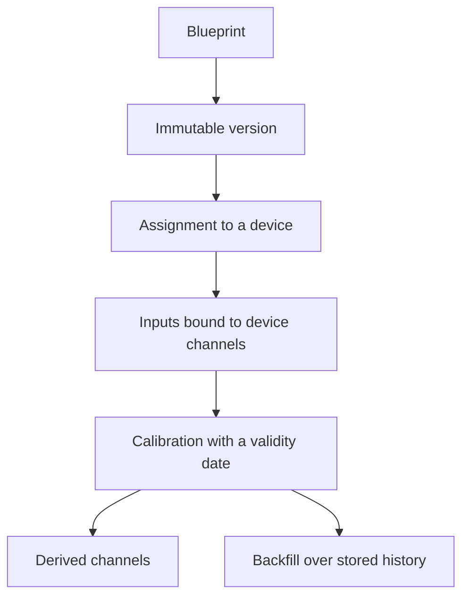

A blueprint is an ordered list of named algorithms from `GET /algorithms`. Owners edit blueprints under **Automation → Blueprints** (`/console/blueprints`). Each owner can view their own blueprints and all public blueprints.

Blueprints and device assignments are versioned independently, so editing a blueprint does not alter devices that are already running it.

<Callout type="info" title="Calibration belongs to the device">
The blueprint names the algorithm. The device stores the calibration values together with `valid_from`, so reprocessing historical data applies the calibration that was in force at the time.
</Callout>

## Versioning

Changes to the name, the description, or the public flag modify the blueprint in place. Changes to the steps create a **new version**, copied from the latest one. Devices are assigned to a specific version, so the formula applied to a running device never changes without an explicit update.

Each step has:

- a key and a position, both unique within the version
- `function_name`, which must exist in the algorithm catalogue
- `inputs`: each algorithm input is either `slot:<name>` or `step:<key>.<output>`
- `params` for configuration. Parameters marked as calibration are not set here.
- `outputs`: each algorithm output becomes a derived field name

Renaming a slot or a step updates every reference to it. The console validates the same rules as the API before the form is submitted.

## Device assignment

On the device page, a postprocessing assigns one blueprint version to the device:

- each input slot is bound to a channel of the device
- `output_prefix` is prepended to every derived field, so the same blueprint can run more than once on a device
- `tolerance_seconds` is the maximum time difference between samples that are treated as simultaneous. A null value applies half of the device's reading interval.
- `is_enabled` starts and stops the postprocessing

Derived channels appear as measurements whose `produced_by` field refers to the postprocessing. The catalogue type of a derived channel is removed when the last channel that uses it is deleted, so an obsolete unit cannot block a later assignment.

## Calibration

Calibration is stored on the device, not on the blueprint. `StepCalibration` records are append-only and contain a step key, the algorithm name, the parameters, and `valid_from`. Reprocessing historical data applies the calibration in force at the time of each sample. A calibration applies only while the step uses the same algorithm.

If a calibration function fails on a reading, the error is logged and the raw value is passed through unchanged.

## Backfill

A backfill (`POST` on the postprocessing) runs the blueprint again over a stored time range. `include_dependants` also reruns, in order, the postprocessings that read this postprocessing's outputs. The status progresses through `pending`, `running`, `done`, and `failed`, and the record stores the number of points published.

A backfill loads the required channels over the selected range, aligns them to the reading interval, runs the steps in order, and writes the results to the `derived` measurement, tagged with the blueprint. Pointwise algorithms can also run on each incoming sample; windowed algorithms run only as scheduled jobs.
