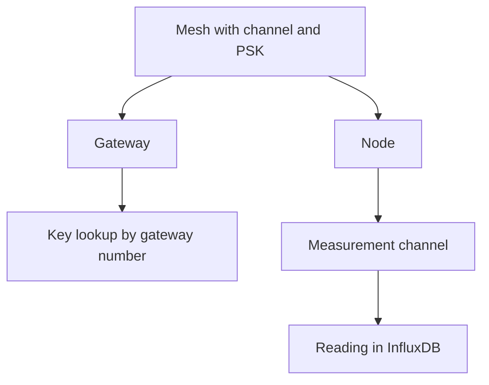

## Mesh

A mesh is one physical Meshtastic network. The diagram shows how the main entities relate.

<Callout type="info" title="Two meanings of channel">
The Meshtastic channel is the radio channel name together with its key. A measurement channel is one quantity from one device, such as `environment_metrics.temperature`. In this documentation, channel means a measurement channel unless the radio channel is named.
</Callout>

A mesh has a channel name and a pre-shared key (PSK). The decoder uses that pair to turn packets into readings. Once stored, the PSK is write-only in the API: the owner can view it in the console, and the readings API never returns it.

A mesh is **public** when any verified owner, and an unauthenticated API client, may read its devices and readings. Public access never includes writes. Only the owner or a superuser can change the mesh, reject a node, or view rejected nodes.

Traffic arrives on this instance's broker, or through a [source](/sources): a remote broker and topic that an operator imports.

## Gateway and node

A **device** is one Meshtastic radio, registered as a gateway or as a node.

- A **gateway** publishes packets to MQTT. The decoder finds the mesh key from the gateway's node number, so an allowed gateway's node number must be unique on the instance.
- A **node** is any other radio on the mesh. The same node number can exist on two meshes, for example when two sources receive the same radio.

The node number is the Meshtastic identifier. The console shows it in the hexadecimal form used by Meshtastic clients. The registration identifier, a UUID, is what the API uses for the device record.

`is_allowed = false` rejects a device, and the decoder drops its packets. Rejection does not delete the device. The record stays so the device can be allowed again.

## Channel

Channel has two meanings.

- The **Meshtastic channel** is the radio channel name together with the PSK. It belongs to the mesh.
- A **measurement channel** is one quantity from one device, named `measurement.field`. `environment_metrics.temperature` is a measurement channel. Blueprints, quality checks, and stored readings all refer to channels by this name.

A **telemetry variant** is a protobuf message type, such as `telemetry:environment_metrics`, or a fixed type such as `device:position`. The catalogue lists the quantities each variant can produce. The first time a device reports a variant, the platform creates the matching channels for that device.

## Reading

A reading is one numeric sample, stored in InfluxDB with the mesh identifier and the node identifier. Derived channels, quality metrics, and alarms are stored as readings too, under their own measurement names. See [Data stores](/data).

## Roles

| Role | Permissions |
| --- | --- |
| Member (owner) | Create and manage owned meshes and devices. Read public meshes. Request the operator role. |
| Operator | All member permissions, plus sources, sinks, and the Parquet archive on owned meshes. |
| Staff | Read the catalogue. No access to PSKs and no write access. |
| Superuser | Read and write access to every mesh, including keys. |

An operator is still the owner of their own meshes. The extra permissions cover shared ingestion and publishing data to other parties.

## Source and sink

A **source** imports data. It is a remote MQTT broker. Matching topics are copied into this instance.

A **sink** exports data. It is a set of credentials on this instance's broker. An external consumer subscribes with those credentials and receives the streams the operator selected: decoded readings, derived channels, alarms, or any mix of them.

The archive is a separate export: hourly Parquet files in object storage, turned on per device.
