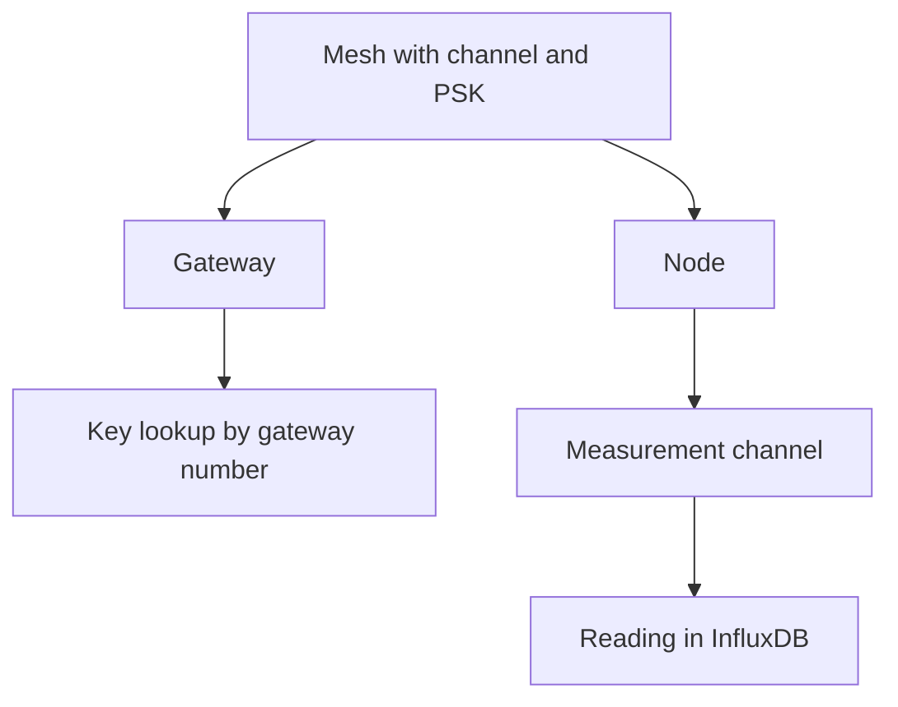

## Mesh

A mesh is a single physical Meshtastic network. The following diagram shows how the main entities relate to each other.

<Callout type="info" title="Two meanings of channel">
The Meshtastic channel is the radio channel name together with its key. A measurement channel is a single quantity reported by a single device, such as `environment_metrics.temperature`. In this documentation, channel refers to a measurement channel unless the radio channel is stated explicitly.
</Callout>

A mesh has a channel name and a pre-shared key (PSK). The decoder uses this pair to decrypt packets into readings. Once stored, the PSK is write-only in the API: the owner can view it in the console, and the readings API never exposes it.

A mesh is **public** when any verified owner, as well as an unauthenticated API client, may read its devices and readings. Public access never extends to write operations. Only the owner or a superuser can modify the mesh, reject a node, or view rejected nodes.

Traffic is received on the instance's own broker, or through a [source](/docs/sources): a remote broker and topic imported by an operator.

## Gateway and node

A **device** is a single Meshtastic radio, registered either as a gateway or as a node.

- A **gateway** publishes packets to MQTT. The decoder identifies the mesh key by the gateway's node number, so the node number of an allowed gateway must be unique across the instance.
- A **node** is any other radio on the mesh. The same node number may exist in two meshes, for example when two sources receive the same radio.

The node number is the Meshtastic identifier. The console displays it in the hexadecimal format used by Meshtastic clients. The registration identifier, a UUID, is the identifier the API uses for the device record.

Setting `is_allowed = false` rejects a device, and the decoder discards its packets. Rejection does not delete the device: the record is retained so that the device can be allowed again.

## Channel

The term channel has two distinct meanings.

- The **Meshtastic channel** is the radio channel name together with the PSK. It belongs to the mesh.
- A **measurement channel** is a single quantity reported by a single device, named `measurement.field`. For example, `environment_metrics.temperature` is a measurement channel. Blueprints, quality checks, and stored readings all refer to channels by this name.

A **telemetry variant** is either a protobuf message type, such as `telemetry:environment_metrics`, or a fixed type such as `device:position`. The catalogue lists the quantities each variant can produce. When a device first reports a variant, the platform creates the corresponding channels for that device.

## Reading

A reading is a single numeric sample, stored in InfluxDB with the mesh identifier and the node identifier. Derived channels, quality metrics, and alarms are also stored as readings, under their own measurement names. See [Data stores](/docs/data).

## Roles

| Role | Permissions |
| --- | --- |
| Member (owner) | Create and manage owned meshes and devices. Read public meshes. Request the operator role. |
| Operator | All member permissions, plus sources, sinks, and the Parquet archive on owned meshes. |
| Staff | Read the catalogue. No access to PSKs and no write access. |
| Superuser | Read and write access to every mesh, including keys. |

An operator remains the owner of their own meshes. The additional permissions concern shared ingestion and the publication of data to third parties.

## Source and sink

A **source** imports data. It is a remote MQTT broker whose matching topics are copied into the instance.

A **sink** exports data. It is a set of credentials on the instance's broker. An external consumer subscribes with those credentials and receives the streams selected by the operator: decoded readings, derived channels, alarms, or any combination of them.

The archive is a separate export mechanism: hourly Parquet files in object storage, enabled per device.
