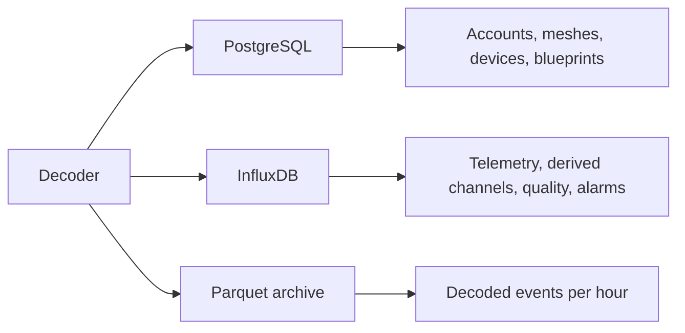

The platform stores data in three places. PostgreSQL holds the registry of accounts and devices. InfluxDB holds the measurements. The Parquet archive holds a long-term copy of decoded events for devices that opt in.

<Callout type="info" title="Mesh keys">
Mesh keys are stored only in the registry. The readings API cannot read them.
</Callout>

## PostgreSQL

PostgreSQL holds the registry: accounts, meshes, devices, the telemetry catalogue, blueprints, sources, and sinks. It also records accepted terms and scheduled data deletions.

The main relationships are as follows. An owner has any number of meshes and blueprints. A mesh has any number of devices. A device has any number of measurement channels and postprocessings. A public blueprint can be assigned by an owner who does not own it, but only its owner can edit it.

Each measurement type in the catalogue has a quantity kind: `physical_property`, `concentration`, `count`, `ratio`, or `other`. An optional `vocabulary_uri` refers to a QUDT or EIONET concept.

## InfluxDB

A channel is named `measurement.field`. `payload_kind` always has the form `namespace:measurement`, and the measurement part is the InfluxDB measurement name.

| Namespace | Measurement | Origin | Typical fields |
| --- | --- | --- | --- |
| `telemetry` | Protobuf variant name (`environment_metrics`, …) | Measured | Numeric fields of that message |
| `device` | `position` | Device | `latitude`, `longitude`, `altitude` |
| `device` | `nodeinfo` | Device | `user_id`; tags for the long name, short name, hardware, and role |
| `computed` | `derived` | Blueprint | Outputs, tagged with `blueprint_id` |
| `computed` | `quality` | Completeness check | Fill ratio and gap metrics |
| `computed` | `alarms` | Detectors | `message` and an optional `value` |

Telemetry points carry the tags `mesh_id` and `node_id`, and optionally `channel_id` and `gateway_id`. Every point also carries `packet_id` and `timestamp_quality` (`rx_time` or `payload`). Alarm points are tagged with `detector`, `mesh_id`, `node_id`, an optional `channel`, and `source` (`stream` or `batch`).

Text messages and routing packets are not stored.

## Parquet

The archive contains one object per mesh and UTC hour. The columns include `node_id`, `packet_id`, `portnum`, `rx_time`, `hop_start`, `channel_id`, `gateway_id`, `payload_kind`, and `payload_json`. When a partition is rewritten, rows are deduplicated on `(node_id, packet_id, rx_time, payload_kind)`.

Only devices with `archive_enabled` are archived. See [Archive](/docs/archive).
