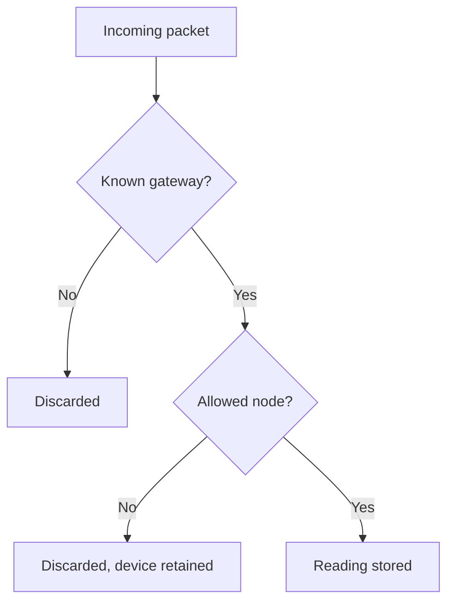

A device is registered with `POST /devices` from the mesh page, providing the Meshtastic node number, whether the device is a gateway, and an optional label. The decoder also registers devices from packets it can already decrypt, and gateway discovery can register gateways when the mesh allows it.

The decoder applies two checks before storing a packet. A packet that fails either check is discarded.

<Callout type="info" title="Rejection is not deletion">
`is_allowed = false` instructs every decoder to discard the node's packets. The device record is retained, so the device can be allowed again. Public readers cannot view rejected devices.
</Callout>

The inventory at `/console/devices` lists every device the user can access. It can be filtered by mesh, gateway, allowed status, and attached blueprint. Each row opens the device page.

## Gateway or node

`is_gateway` identifies the MQTT publisher. The decoder uses the gateway's node number to find the PSK, so two allowed gateways cannot share a node number anywhere on the instance. Ordinary nodes need only be unique within their mesh.

Up to three Meshtastic administration keys (`admin_keys_b64`) can be stored on a device, matching the firmware limit of three `admin_key` entries. Only the mesh owner can view them.

## Allowed and rejected devices

When `is_allowed = false` is set, the decoder discards the device's packets. The device remains in the registry and can be allowed again. Public readers cannot view rejected devices.

## Identity and location

NodeInfo packets update `name`, `short_name`, `hardware_type`, and `role` until `nodeinfo_overridden` is set. Position packets update latitude and longitude until `location_overridden` is set. Once a flag is set, later packets no longer overwrite the values entered manually.

`last_seen` records the last time the decoder received a packet from the device. `discovered_at` is set when gateway discovery created the device record.

## Intervals

`reading_interval_seconds` is the expected sampling interval of the sensor. Detectors and blueprint alignment use this value. `publish_interval_seconds` is the expected transmission interval of the radio; the absence detector compares periods of silence against it.

Both values can be left empty when they are not yet known. The telemetry variant in the catalogue can provide a default reading interval until the device has its own.

## Device channels

The device page lists the telemetry variants (`GET /devices/{id}/telemetry-variants`) and the active channels (`GET /devices/{id}/measurements`). A channel is created when its variant is first received; channels such as `environment_metrics.temperature` are never created manually.

Each channel supports the following settings:

- `enabled_detectors = null` inherits the catalogue default.
- `enabled_detectors = []` disables detectors on the channel.
- `valid_min` and `valid_max` are set together for the range detector. When both are empty, the range is not checked.

Absence detection is not configured per channel. It is enabled with `absence_detection_enabled` on the device. See [Quality and alarms](/docs/quality).

## Archive

`archive_enabled` includes the device in the Parquet archive. The API accepts this setting only on a mesh whose owner is an operator, and only when the instance provides an archive. Disabling it stops the creation of new files and retains the files already written. The console labels this setting **S3 storage**. See [Archive](/docs/archive).
