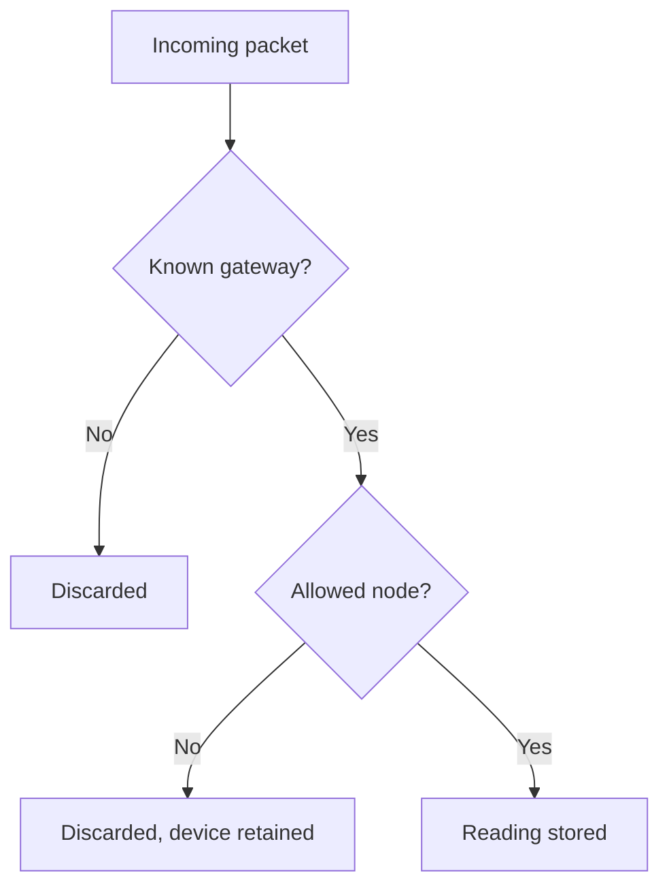

Register a device with `POST /devices` from the mesh page: the Meshtastic node number, whether it is a gateway, and an optional label. The decoder also registers devices from packets it can already decrypt. Gateway discovery can register gateways when the mesh allows it.

The decoder checks two things before it stores a packet. A packet that fails either check is discarded.

<Callout type="info" title="Rejection is not deletion">
`is_allowed = false` tells every decoder to discard that node's packets. The device record stays, so you can allow it again. Public readers cannot view rejected devices.
</Callout>

The inventory at `/console/devices` lists every device you can access. Filter by mesh, gateway, allowed status, and attached blueprint. Each row opens the device page.

## Gateway or node

`is_gateway` marks the MQTT publisher. The decoder uses the gateway's node number to find the PSK, so two allowed gateways cannot share a node number anywhere on the instance. Ordinary nodes only need to be unique within their mesh.

A device can store up to three Meshtastic administration keys (`admin_keys_b64`), the same limit as three `admin_key` entries in the firmware. The mesh owner and a superuser can view them.

## Allowed and rejected devices

Set `is_allowed = false` to reject a device. The decoder discards its packets. The record stays in the registry, and you can allow the device again. Public readers cannot view rejected devices.

## Identity and location

NodeInfo packets update `name`, `short_name`, `hardware_type`, and `role` until `nodeinfo_overridden` is set. Position packets update latitude and longitude until `location_overridden` is set. After a flag is set, later packets leave the values you entered alone.

`last_seen` is the last time the decoder received a packet from the device. `discovered_at` is set when gateway discovery created the record.

## Protocol and firmware

`protocol` is the Meshtastic version the device's packets are decoded with, which is always its mesh's. A device with its own MQTT uplink and map reports turned on also sends `firmware_version`, `region`, and `modem_preset`, and `firmware_protocol` is the version that firmware speaks. Other devices leave those fields empty.

`protocol_mismatch` is set when some readings from the device are lost or misread under its mesh's version. Either the device sends fields that version does not know, and `observed_protocol` names the version that decodes them, or its firmware is older than the mesh's version. The device page explains which one applies. Update the device's firmware, or move the mesh to the version its devices run. Owners who turn on status alerts get an email when a device runs a newer version than its mesh.

## Intervals

`reading_interval_seconds` is how often you expect the sensor to sample. Detectors and blueprint alignment use it. `publish_interval_seconds` is how often you expect the radio to transmit. The absence detector compares silence against it.

Leave either value empty when you do not know it yet. The telemetry variant in the catalogue can supply a default reading interval until the device has its own.

## Device channels

The device page lists telemetry variants (`GET /devices/{id}/telemetry-variants`) and active channels (`GET /devices/{id}/measurements`). A channel is created the first time its variant is received. Channels such as `environment_metrics.temperature` are never created by hand.

Each channel has these settings:

- `enabled_detectors = null` inherits the catalogue default.
- `enabled_detectors = []` turns detectors off on that channel.
- `valid_min` and `valid_max` are set together for the range detector. When both are empty, the range is not checked.

Absence detection is not set per channel. Turn it on with `absence_detection_enabled` on the device. See [Quality and alarms](/quality).

## Archive

`archive_enabled` includes the device in the Parquet archive. The API accepts this only on a mesh whose owner is an operator, and only when the instance has an archive. Turning it off stops new files and keeps the files already written. The console calls this setting **S3 storage**. See [Archive](/archive).
