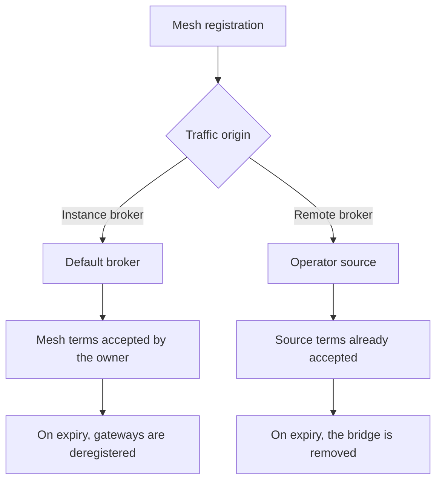

A mesh is registered with `POST /meshes`, providing a channel identifier, a PSK, and an optional label. The key is distributed to the decoders, so packets are decrypted without querying the API for each one.

The origin of the traffic determines which terms apply and what happens when those terms expire.

<Callout type="warn" title="Public access is read-only">
`is_public` allows other owners and unauthenticated API clients to read devices and history. It does not allow them to modify the mesh, view the PSK, or view rejected nodes.
</Callout>

The console lists the owner's meshes at `/console/meshes`. The detail page of a mesh shows its gateways and nodes together.

## Access control

| Action | Permitted for |
| --- | --- |
| Read devices and readings | The owner, a superuser, and any client when `is_public` is set. Unauthenticated API clients can read public meshes only. |
| View the PSK | The owner and a superuser. Staff and public readers cannot view it. |
| View rejected nodes | The owner and a superuser. |
| Edit or delete the mesh, register devices | The owner and a superuser. |

## Traffic origin

`source` is null when packets arrive on the instance's own broker. An operator can assign the mesh to one of their [sources](/sources) instead. Removing a mesh from a source, or deleting the mesh, schedules the deletion of its stored readings after a grace period.

On the default broker, the mesh terms apply, and the owner acts as data controller for that traffic. On a source, the source terms apply and the mesh form does not request acceptance again. When the terms expire:

- On the default broker, the mesh is paused and its gateways are deregistered until the owner renews the terms.
- On a source, the bridge for that source is removed until the operator renews the terms.

The status column in the console lists the most urgent states first: scheduled for deletion, source paused, source disconnected, terms changed, renewal due, terms not yet accepted, source status unknown, and active. On instances that do not require acceptance of terms, meshes are shown as active unless the bridge itself is unhealthy.

## Gateway discovery

`discover_gateways` allows the platform to register gateways whose packets decrypt with the channel and PSK of this mesh, without the owner adding each gateway manually. Discovery is rate-limited to approximately 50 gateways per minute, so that a busy broker cannot overload the registry. Nodes behind a discovered gateway are registered as their packets are decoded.

A device registered in this way has `discovered_at` set, and it can be rejected like any other device.

## Public meshes

`is_public` should be enabled when viewers need read access to the fleet and its history. Public readers cannot modify the mesh, view the PSK, or view rejected devices.

## Deleting a mesh

Deleting a mesh does not remove its readings in the same request. A data deletion job is scheduled with the reason `mesh_deleted` and runs after `delete_after`. A job is also scheduled when a mesh is removed from its source (`source_detached`) or when the source terms expire (`terms_lapsed`). Renewing the terms, or assigning the mesh to the same source again, can cancel a pending job.
