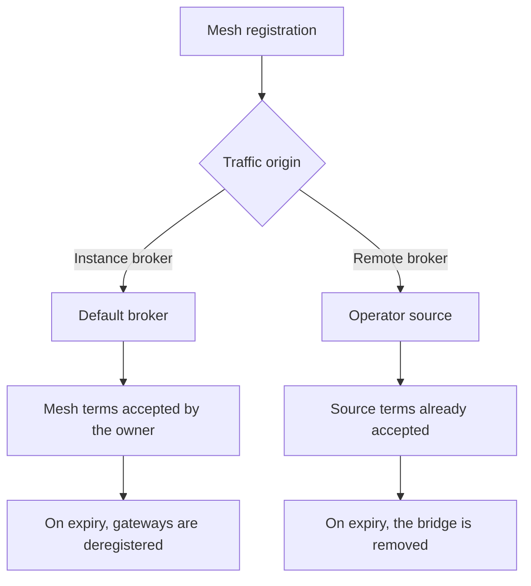

Register a mesh with `POST /meshes`: a channel identifier, a PSK, and an optional label. The key is sent to the decoders, so packets are decrypted without calling the API for each one.

Where the traffic comes from decides which terms apply, and what happens when those terms expire.

<Callout type="warn" title="Public access is read-only">
`is_public` lets other owners and unauthenticated API clients read devices and history. It does not let them change the mesh, view the PSK, or view rejected nodes.
</Callout>

The console lists your meshes at `/console/meshes`. The mesh page shows its gateways and nodes together.

## Access control

| Action | Permitted for |
| --- | --- |
| Read devices and readings | The owner, a superuser, and any client when `is_public` is set. Unauthenticated API clients can read public meshes only. |
| View the PSK | The owner and a superuser. Staff and public readers cannot view it. |
| View rejected nodes | The owner and a superuser. |
| Edit or delete the mesh, register devices | The owner and a superuser. |

## Traffic origin

`source` is null when packets arrive on the instance's own broker. An operator can attach the mesh to one of their [sources](/sources) instead. Removing a mesh from a source, or deleting the mesh, schedules deletion of its stored readings after a grace period.

On the default broker, the mesh terms apply, and the owner is the data controller for that traffic. On a source, the source terms apply, and the mesh form does not ask for acceptance again. When the terms expire:

- On the default broker, the mesh is paused, its gateways are deregistered, and its readings are scheduled for deletion, until the owner renews the terms.
- On a source, the bridge for that source is removed, and readings for its meshes are scheduled for deletion, until the operator renews the terms.

The status column lists the most urgent state first: Scheduled for deletion, Source paused, Source disconnected, Terms changed, Renew soon, Terms not accepted, Source status unknown, then Active. On an instance that does not require terms, a mesh on the default broker is shown as Active. A mesh on a source follows the bridge: paused, disconnected, unknown, or active.

## Gateway discovery

`discover_gateways` registers gateways whose packets decrypt with this mesh's channel and PSK, so you do not add each gateway by hand. Discovery is limited to about 50 gateways per minute, so a busy broker cannot overload the registry. Nodes behind a discovered gateway are registered as their packets are decoded.

A device created this way has `discovered_at` set. You can reject it like any other device.

Only an operator can turn discovery on for a mesh that uses a default or blank PSK. That key matches every gateway on the channel.

## Public meshes

Turn on `is_public` when other people need to read the fleet and its history. Public readers cannot change the mesh, view the PSK, or view rejected devices.

## Deleting a mesh

Deleting a mesh does not remove its readings in the same request. A data deletion job is scheduled with the reason `mesh_deleted` and runs after `delete_after`. A job is also scheduled when a mesh is removed from its source (`source_detached`), when the mesh terms expire on the default broker (`terms_lapsed`), or when the source terms expire (`terms_lapsed`, with that source). Renewing the terms, or attaching the mesh to the same source again, can cancel a pending job.
