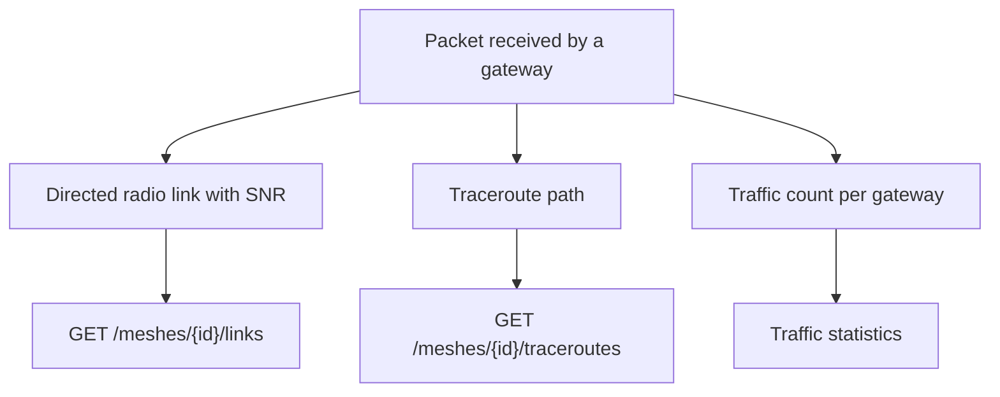

Besides sensor values, the decoder records how the radio network is put together: which nodes hear which, the path of each traceroute, and how much traffic each gateway handles.

One packet can feed three different records. Each answers a different question.

<Callout type="info" title="Traffic is separate from sensor data">
Traffic statistics count packets. A node can put a lot of traffic on the mesh and still report no sensor channel.
</Callout>

On a public mesh, links, traceroutes, and traffic statistics can be read without credentials.

## Radio links

`GET /meshes/{id}/links` returns directed hops. `from_node` transmitted. `to_node` measured the SNR. The same pair heard both ways is two links. A link is stored separately for each way it was observed:

| Method | Meaning |
| --- | --- |
| `traceroute` | A hop listed in a traceroute |
| `neighborinfo` | A neighbour report: the neighbour transmitted, and the reporting node heard it |
| `direct` | A packet a gateway received with no hop in between. Direct links are added once an hour. |

Each row has `samples`, `snr_mean` (dB), `last_snr` (null when the packet had no measurement), `first_seen`, `last_seen`, the device ids when those nodes are registered, and `distance_km` when both have a position. SNR values that do not line up with a known traceroute hop are dropped. The packet is still kept.

`since` is `24h`, `7d`, or `30d`. The default is `7d`. Links not heard for 30 days are deleted.

## Traceroutes

`GET /meshes/{id}/traceroutes` returns traceroute packets, newest first. One traceroute is stored once, however many gateways heard it. The longest route seen is kept. `gateway_ids` lists the gateways that heard it.

`from_node` sent this packet and `to_node` was its destination. On a reply (`request_id` set), those two fields are the reverse of the original traceroute. `origin` started it and `target` is where it was going. `towards` and `snr_towards` run from origin toward target. `back` and `snr_back` run home. A reply can carry both directions. A request only has the hops taken so far. SNR is in dB, and null where it was not measured. `complete` is true when `towards` reaches the target.

Traceroutes are kept for 30 days. `limit` defaults to 50 and stops at 500. Pass `before` as the `heard_at` of the last row to read the next page.

## Traffic

Every packet a registered gateway receives is counted, including text, routing, and packets that could not be decrypted. A packet heard by several gateways is one packet and several receptions. Rejected nodes count in the totals and are not listed as nodes.

- `GET /readings/meshes/{id}/stats` returns mesh figures: gateway overlap, relays, and activity. Relays are reported as the last byte of a node number, with the registered nodes that byte could be.
- `GET /readings/devices/{uuid}/traffic` and `GET /readings/meshes/{id}/nodes/{node_id}/traffic` return packet types and volume for one node. A null `portnum` is a packet that could not be decrypted.

`range` is `1h`, `24h`, `7d`, or `30d`. The default is `24h`. Hourly figures start at the whole hour on or before the start of the range. The last few minutes can still grow. The same mesh and range are cached for about a minute.

These figures describe radio activity, not the sensor catalogue.
