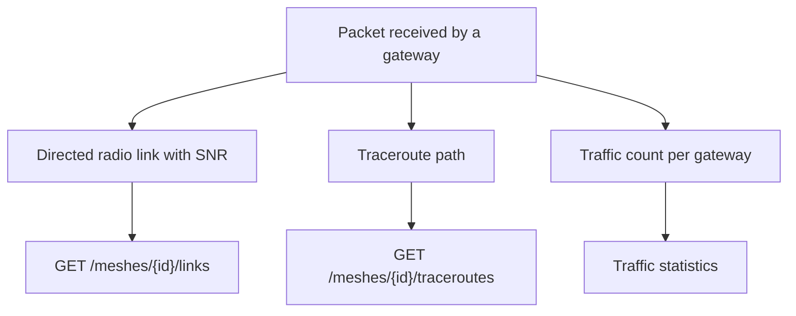

In addition to sensor values, the decoder records the structure of the radio network: which nodes receive which, the path taken by each traceroute, and the volume of traffic handled by each gateway.

A single packet can contribute to three different records. Each one answers a different question, and they are not interchangeable.

<Callout type="info" title="Traffic is independent of sensor data">
Traffic statistics count packets. A node can generate substantial traffic on the mesh without reporting any sensor channel.
</Callout>

## Radio links

`GET /meshes/{id}/links` returns directed hops: `from_node` transmitted the packet, and `to_node` measured its SNR. A link is recorded separately for each method by which it was observed:

| Method | Meaning |
| --- | --- |
| `traceroute` | A hop listed in a traceroute |
| `neighborinfo` | A neighbour report |
| `direct` | A packet received directly from the sender |

Each record stores the number of samples, the sum of SNR values, the latest SNR, and the first and last observation times. SNR is expressed in dB and is null when the packet did not include a measurement. SNR values beyond the known path of a traceroute are ignored rather than rejecting the packet.

## Traceroutes

`GET /meshes/{id}/traceroutes` returns traceroute packets. Each traceroute is stored once, regardless of how many gateways received it. `from_node` sent the packet and `to_node` was its destination. On a reply (`request_id` set), these two fields are reversed relative to the direction of the original traceroute. `route` and `route_back` contain node numbers, and `snr_towards` and `snr_back` contain the corresponding SNR values. `gateway_ids` lists the gateways that received this copy of the packet.

## Traffic

Every packet received by a registered gateway is counted.

- `GET /readings/meshes/{id}/stats` returns mesh-level statistics: gateway overlap, relays, and activity.
- `GET /readings/devices/{uuid}/traffic`, and the equivalent endpoint addressed by node number, return the packet types and volume for a single node.

These statistics describe radio activity, not the sensor catalogue.
