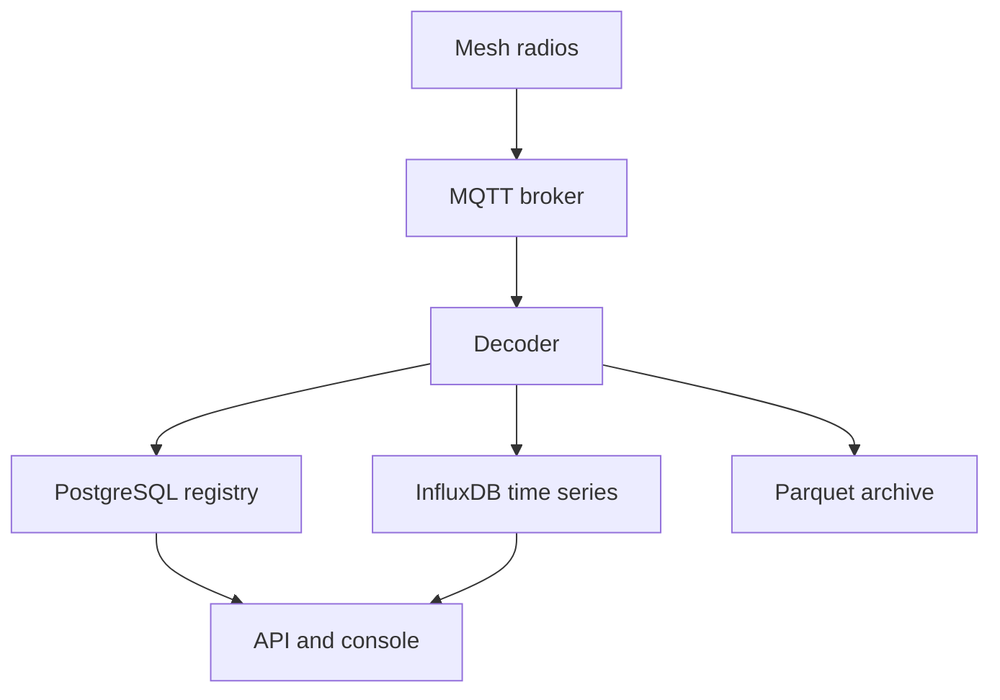

Mesh Things manages a [Meshtastic](https://meshtastic.org/) LoRa mesh as a fleet of registered devices. Gateways publish protobuf packets to an MQTT broker. The platform decrypts those packets with the mesh key, stores the resulting readings, and provides access to them through an HTTP API and the console.

{/* Images live in content/docs/assets and are referenced with a path relative to this file. Vite bundles them at build time; both languages share the same file. */}

Each stage of the pipeline stores a different kind of data. The message bus carries the raw packets, PostgreSQL holds the device registry, and InfluxDB holds the measurements.

## Intended users

- Owners who operate one or more meshes and require a durable record of sensor data.
- Users who need to be notified when a node stops transmitting, a sensor reports a constant value, or a value leaves its valid range.
- Teams that derive additional channels from raw readings, with a calibration that may change over time.
- Operators who import traffic from a remote MQTT broker, or who publish a subset of readings to a third party.
- Viewers who require read-only access to a public mesh.

## Packet processing

1. **Ingestion.** Traffic from the MQTT broker is copied into the platform as raw packets. The broker can be the instance's own broker or a remote broker registered as a [source](/docs/sources).
2. **Decoding.** The decoder decrypts each packet with the mesh pre-shared key and converts it to structured data. Packets from unknown gateways or rejected nodes are discarded.
3. **Cataloguing.** Each packet updates the registry: devices, telemetry variants, and measurement channels are created or refreshed in PostgreSQL.
4. **Storage.** Decoded readings are written to InfluxDB. Devices that opt in are also archived as hourly Parquet files.
5. **Processing.** Detectors evaluate incoming readings, and scheduled jobs apply blueprints and completeness checks to stored history.
6. **Access.** The registry API manages accounts, meshes, devices, and the catalogue. The readings API serves series, latest values, exports, and the archive. The console is built on both.

## Data storage

| Data | Store |
| --- | --- |
| Accounts, meshes, keys, devices, catalogue, blueprints | PostgreSQL |
| Telemetry, positions, node information, derived channels, quality metrics, alarms | InfluxDB |
| Archived decoded events, for devices that opt in | S3-compatible object storage, as Parquet |

The HTTP contract is published as an OpenAPI document at `/schema` on the API host, with an interactive Swagger UI. That reference is maintained separately from this guide.

## Related pages

<Cards>
  <Card title="Concepts" href="/docs/concepts" description="Mesh, gateway, node, and the two meanings of channel." />
  <Card title="Accounts" href="/docs/accounts" description="Registration, authentication, and access to the mesh key." />
  <Card title="Architecture" href="/docs/architecture" description="Platform components and the flow of data between them." />
  <Card title="Data stores" href="/docs/data" description="Contents of PostgreSQL, InfluxDB, and the Parquet archive." />
</Cards>
