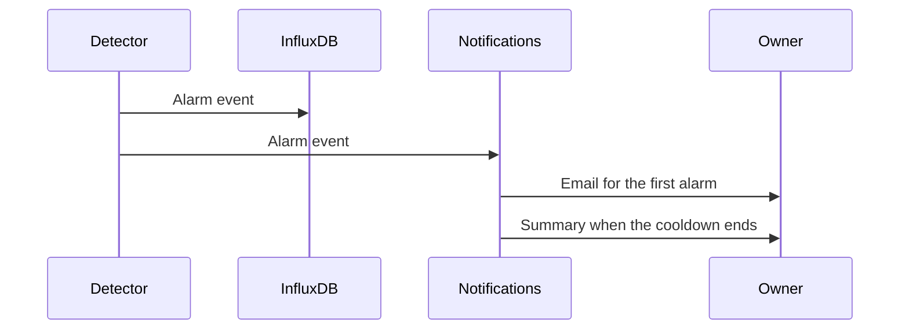

`GET /detectors` lists the detectors. A channel runs the detectors in its `enabled_detectors` list. When that field is null, the channel uses the catalogue default. An empty list turns detection off for the channel. Absence is the exception: it is turned on for the device, because silence is about the radio, not one field.

Each alarm is stored first. Email follows, and most of it is grouped.

<Callout type="info" title="Stream detectors">
`flat_value`, `range`, and `absence` run as readings arrive. They exist only on instances that run stream processing. Completeness runs on a schedule. Windowed blueprint steps do too. Pointwise blueprint steps also run as each sample arrives.
</Callout>

| Detector | Scope | Evaluation | Requirements |
| --- | --- | --- | --- |
| `flat_value` | Channel | Stream | None. Fires when the same value lasts 12 hours and spans at least 3 readings. |
| `range` | Channel | Stream | `valid_min` and `valid_max` on the channel, set or cleared together. Fires after 3 readings in a row outside the range, or 2 when the reading interval is 30 minutes or longer. |
| `absence` | Device | Stream | `absence_detection_enabled`, and `publish_interval_seconds` or the device reading interval. Fires once, after about 3 missed intervals (at least 60 seconds). |
| `completeness` | Channel | Scheduled | `reading_interval_seconds`. Over the last 24 hours, fires when fewer than 80% of the expected readings arrived (and at least 24 were expected), or when a gap is longer than 6 intervals and 30 minutes. |

The 12 hours, 80%, 24 hours, and gap limits are the defaults. An operator can change them on the instance.

Alarm events go to the `alarms` measurement. Tags are the detector, the mesh, the node, an optional channel, and `source` (`stream` or `batch`).

## Email notifications

The first alarm on a device is emailed to the mesh owner at once. Later alarms on that device, from any detector or channel, wait for `alarm_email_cooldown_seconds`. When the wait ends, one summary lists them. A cooldown of 0 sends an email for every alarm. The instance default is 1 hour. The owner can replace it on the profile page.

Absence does not wait. A silent device is emailed immediately, and at most once a day for that device.

A condition that stays active is reminded about once a day (the `repeat` alarms). The instance can set that reminder to 0 and send none. Alarms marked `replay`, from history being reprocessed, are never emailed.

Emails link back to the console.

## Console views

**Automation → Alarms** chooses which conditions are watched on each measurement. On the device page, each channel can inherit that choice, replace it, or turn it off. Absence can be turned on for the whole device.
