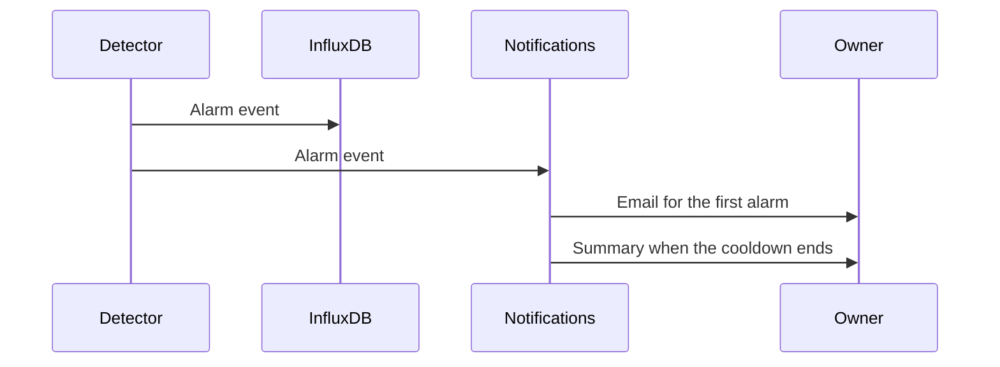

The available detectors are listed by `GET /detectors`. A channel runs the detectors in its `enabled_detectors` list, or the catalogue default when that field is null. An empty list disables detection on the channel. Absence detection is the exception: it is enabled on the device, because a period of silence concerns the radio rather than a single field.

Alarm events and alarm notifications are handled separately. Each event is stored first; email notifications follow and are grouped.

<Callout type="info" title="Stream detectors">
`flat_value`, `range`, and `absence` evaluate readings as they arrive. They are available only on instances that provide stream processing. Completeness checks and blueprints run as scheduled jobs.
</Callout>

| Detector | Scope | Evaluation | Requirements |
| --- | --- | --- | --- |
| `flat_value` | Channel | Stream | A reading interval. The window covers approximately three hours of samples. |
| `range` | Channel | Stream | `valid_min` and `valid_max` on the channel, set together. |
| `absence` | Device | Stream | `absence_detection_enabled` and `publish_interval_seconds`. |
| `completeness` | Channel | Scheduled | `reading_interval_seconds`. Raises an alarm when the fill ratio is low or a gap is long. |

Alarm events are stored in the `alarms` measurement, tagged with the detector, the mesh, the node, an optional channel, and `source` (`stream` or `batch`).

## Email notifications

The first alarm on a device sends an email to the mesh owner immediately. Later alarms on the same device, regardless of detector or channel, are held for `alarm_email_cooldown_seconds`. When that period ends, a single summary email lists the alarms held. A cooldown of 0 sends an email for every alarm.

The owner can override the instance default from the profile page. Emails link back to the console. Owners also receive a daily reminder while alarms remain active.

## Console views

**Automation → Alarms** configures which conditions are monitored on each measurement. On the device page, each channel can inherit, override, or disable that configuration, and absence detection can be enabled for the whole device.
