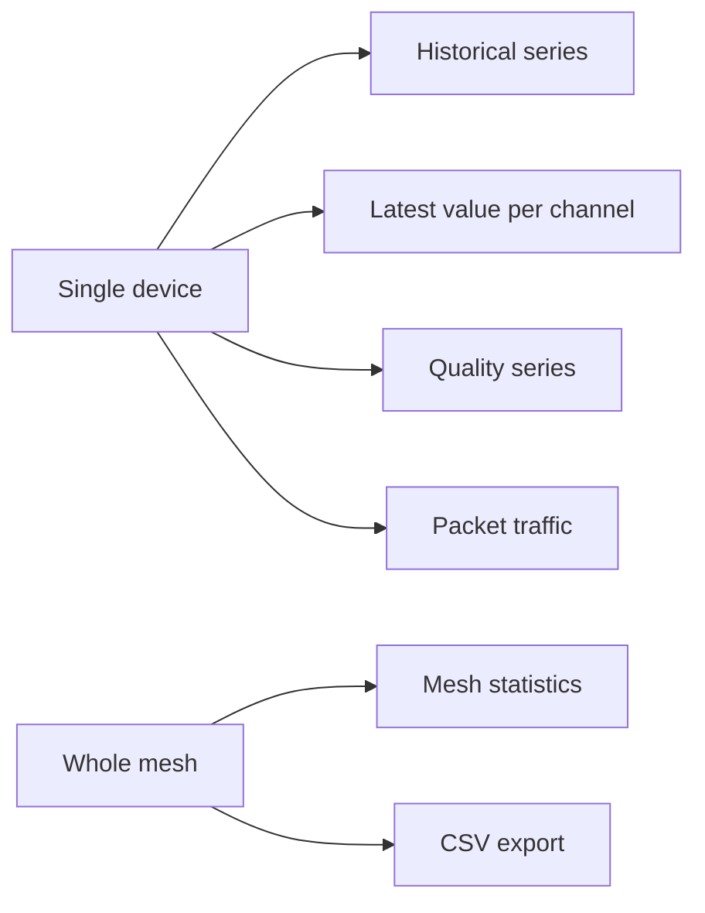

Readings are stored in InfluxDB. The readings API never returns the mesh PSK. A device can be queried by its registration identifier, or by the mesh identifier together with the Meshtastic node number.

The readings API exposes several endpoints over the same store. The appropriate endpoint depends on the data required.

<Callout type="info" title="One export at a time">
A new export requested while another is still being prepared returns 429. The download link remains valid for 24 hours; after that period, the file is deleted and the export must be requested again.
</Callout>

| Data | Endpoint |
| --- | --- |
| Historical samples | `GET /readings/devices/{uuid}` or `GET /readings/meshes/{mesh}/nodes/{node}` |
| Latest value per channel | `.../latest` |
| Quality series | `.../quality` |
| Packet traffic for one node | `.../traffic` |
| Traffic for the whole mesh | `GET /readings/meshes/{mesh}/stats` |

A series is queried with the parameters `channel`, `start`, `stop`, `window`, and `agg`. By default, the device page shows the last 24 hours, aggregated as the mean over one-hour windows, and selects `environment_metrics.temperature` when that channel exists.

`start` and `stop` accept an absolute time or a relative value such as `-24h`. `window` sets the size of each aggregation window. `agg` sets the aggregation function applied within each window: `mean`, or any of the other functions listed by the API.

Latest values appear as cards at the top of the device page, with the value, unit, quantity kind, and time. When no value exists within the lookback period, the card shows an empty state rather than zero.

## CSV downloads

Mesh owners and superusers can export readings as CSV. The device page provides **Download CSV** for a single device. **Data → CSV downloads** (`/console/csv-downloads`) covers a whole mesh or a selection of its devices.

Each export is a ZIP file, prepared in the background.

| Limit | Value |
| --- | --- |
| Maximum range | 366 days |
| Exports in preparation | One at a time. A second request returns 429. |
| Link validity | 24 hours. An email is sent when the export is ready. |
| Export history | 30 days, so that an export can be requested again |

The export states are `queued`, `running` (with the number of days processed out of the total), `ready` (with a signed URL valid until `expires_at`), `failed` (with an error message), and `expired` (the file has been deleted and must be requested again).

Parquet exports from the archive use the same mechanism with `format: parquet`. See [Archive](/archive).

## Rate limits

Requests to the readings API are rate-limited per owner. Superusers are not subject to rate limits.
