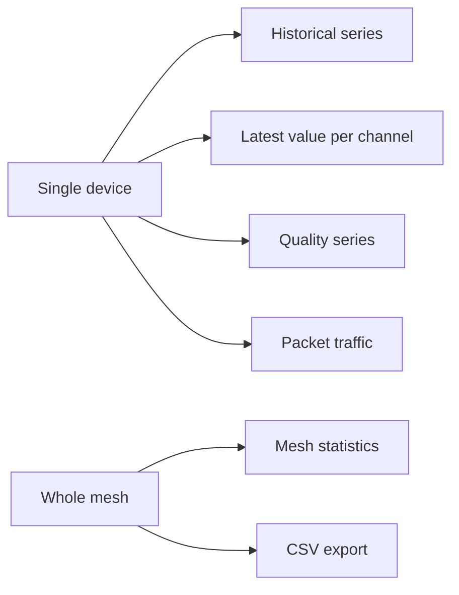

Readings are stored in InfluxDB. The readings API never returns the mesh pre-shared key. Query a device by its registration identifier, or by the mesh identifier together with the Meshtastic node number.

Each endpoint below reads the same store. Pick the one that matches the data you need.

<Callout type="info" title="One export at a time">
A new export requested while another is still being prepared returns 429. The download link stays valid for 24 hours. After that, the file is deleted and you request the export again.
</Callout>

| Data | Endpoint |
| --- | --- |
| Historical samples | `GET /readings/devices/{uuid}` or `GET /readings/meshes/{mesh}/nodes/{node}` |
| Latest value per channel | `.../latest` |
| Quality series | `.../quality` |
| Packet traffic for one node | `.../traffic` |
| Traffic for the whole mesh | `GET /readings/meshes/{mesh}/stats` |

A series needs `channel` or `payload_kind`, plus `start` and `stop`. `window` and `agg` are optional. `channel` is one series, such as `environment_metrics.temperature`. `payload_kind` is a family, such as `telemetry:environment_metrics`, and returns every channel in it. When both are set, `channel` wins.

`start` and `stop` take an absolute time or a relative value such as `-24h`. On the API, `start` defaults to `-1h` and `stop` to `now()`. `window` groups samples into buckets, for example `1h`. It is off unless you set it. `agg` is the function inside each bucket: `mean`, `max`, `min`, `last`, `first`, `sum`, or `count`. It applies only when `window` is set, and defaults to `mean`.

The device page opens on the last 24 hours, with the mean over one-hour windows.

Latest values are cards at the top of the device page: value, unit, quantity kind, and time. The API looks back 30 days unless you set `lookback`. A channel with no sample in that period shows an empty state, not zero.

## CSV downloads

Mesh owners and superusers can export readings as CSV. The device page has **Download CSV** for one device. **Data → CSV downloads** (`/console/csv-downloads`) covers a whole mesh or a selection of its devices.

Each export is a ZIP file, built in the background.

| Limit | Value |
| --- | --- |
| Maximum range | 366 days by default |
| Exports in preparation | One at a time. A second request returns 429. |
| Export requests | 30 per hour per owner, on top of the readings limit below |
| Link validity | 24 hours. If the instance sends mail, the owner is emailed when the export is ready or has failed. |
| Export history | 30 days, so an export can be requested again |

An export moves through `queued`, `running` (days processed out of the total), `ready` (a signed URL valid until `expires_at`), `failed` (an error message), and `expired` (the file is gone; request it again).

Parquet exports from the archive use the same path with `format: parquet`. See [Archive](/archive).

## Rate limits

Readings requests are limited per owner, 120 per minute by default. Anonymous reads of a public mesh are limited to 60 per minute. Superusers are not rate-limited.
