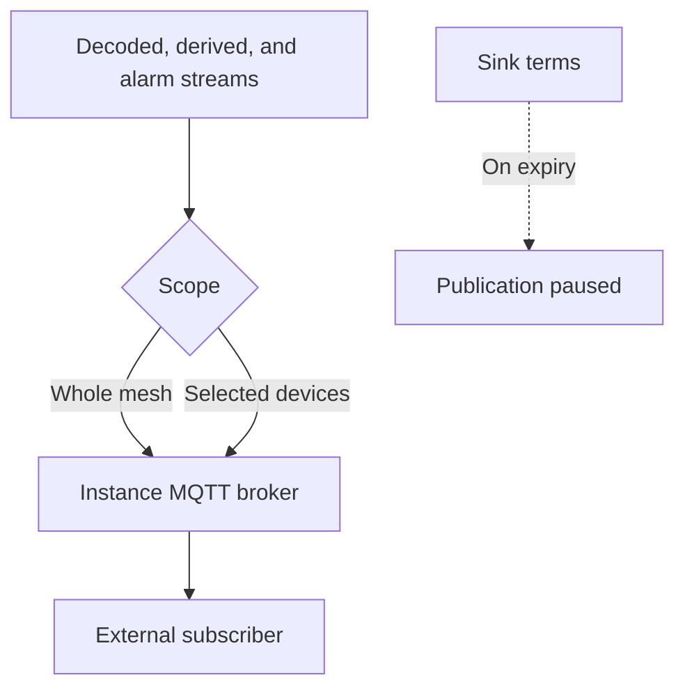

A sink exports data. A source imports it. An operator publishes readings on the instance MQTT broker. A consumer the operator chooses subscribes with its own username and password. The broker stores the password as a hash. The API shows the password once, when it is set or issued again.

The operator chooses the streams and the devices. The consumer never receives the mesh key.

<Callout type="warn" title="The password is shown once">
Issuing a new password disconnects the consumers that are connected. Deleting the sink revokes its credentials. A sink cannot be deleted while meshes or devices are attached to it.
</Callout>

Sinks exist only on instances whose broker supports them. On other instances every sink endpoint returns 404, and the console says the feature is unavailable.

Only operators and superusers manage sinks. An operator sees only the sinks they created. The page is **Data → Sinks** (`/console/sinks`).

## Published streams

`streams` is a non-empty subset of `decoded`, `derived`, and `alarms`, stored in that order.

Readings are published from either:

- a whole mesh, including nodes added later, or
- devices chosen one by one

Choosing the mesh disables the device checkboxes. Those devices are marked as included with the mesh. Clearing the mesh restores the devices that were selected before, and those devices are what gets stored. On edit, each list you send replaces the current list. Credentials do not change on edit.

You need edit access to the mesh or device, and the mesh owner must be an operator. A superuser can attach sinks to an operator's meshes.

## Credentials

Creating a sink and **Issue a new password** both return the password once, with the broker address, username, topic filter, and a `mosquitto_sub` command that keeps a persistent session. The session queues messages while that client is offline. The queue is kept only for a client that has connected before. It is dropped after the instance offline limit (24 hours unless set otherwise) or when it passes the queue limit (10,000 messages unless set otherwise). A client that is still connected and over that queue is disconnected. Issuing a new password disconnects current consumers. If the broker cannot store the new password, the API returns 502 and the old password stays. Deleting the sink revokes its credentials.

A sink cannot be deleted while meshes or devices are attached. The API returns 409. Edit the sink and remove them first.

## Terms

Each sink creation accepts the current sink terms. The operator is responsible for the data the sink publishes and for who receives the credentials. If acceptance expires, `paused_at` is set: nothing is published, and consumer connections are refused, until the creator renews the terms. Renewal uses the same credentials. If the broker cannot resume the sink, renewal returns 502 and the terms stay as they were.

The list shows whether each sink is publishing or paused, how many meshes and devices it covers, and how many consumers are connected. When the broker does not answer, the connection count is a dash.
