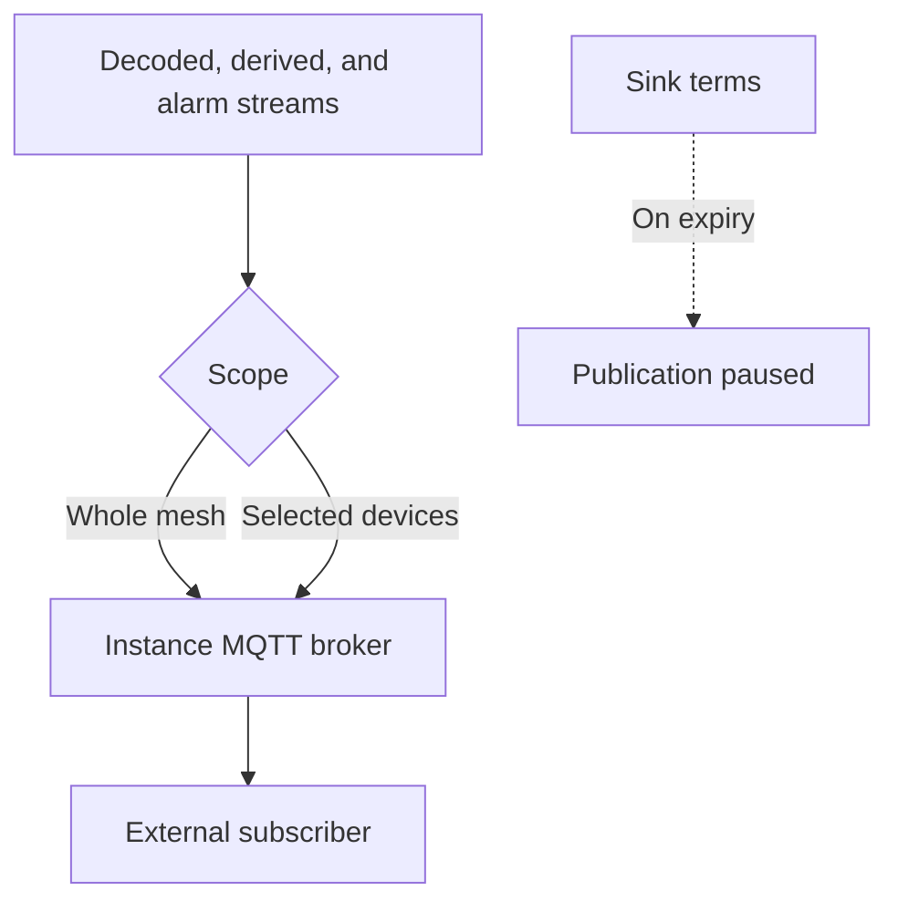

A sink exports data, whereas a source imports it. An operator publishes readings on the instance's MQTT broker, and a consumer designated by the operator subscribes with its own username and password. The broker stores the password as a hash, and the API displays it only once, when it is set or reissued.

The operator selects the streams and the devices. The consumer never has access to the mesh key.

<Callout type="warn" title="The password is displayed once">
Issuing a new password disconnects the consumers currently connected. Deleting the sink revokes its credentials. A sink cannot be deleted while meshes or devices are attached to it.
</Callout>

Sinks are available only on instances whose broker supports them. On other instances, every sink endpoint returns 404 and the console indicates that the feature is unavailable.

Only operators and superusers manage sinks, and an operator can view only the sinks they created. The page is located at **Data → Sinks** (`/console/sinks`).

## Published streams

`streams` is a non-empty subset of `decoded`, `derived`, and `alarms`, stored in that order.

The data is published from either:

- a whole mesh, including nodes added later, or
- individually selected devices

Selecting the mesh disables the device checkboxes, which are marked as included with the mesh. Clearing the mesh selection restores any devices previously selected, and those devices are the ones stored. On edit, each list sent replaces the current list. Credentials do not change on edit.

The user must have edit access to the mesh or device, and the mesh owner must be an operator. A superuser can attach sinks to an operator's meshes.

## Credentials

Creating a sink and **Issue a new password** both return the password once, together with the broker address, username, topic filter, and a `mosquitto_sub` command that maintains a persistent session. Issuing a new password disconnects the current consumers. Deleting the sink revokes its credentials.

A sink cannot be deleted while meshes or devices are attached to it. In that case, the API returns 409, and the sink must be edited to remove them first.

## Terms

Each sink creation accepts the current sink terms. The operator is responsible for the data the sink publishes and for the parties who receive the credentials. If the acceptance expires, `paused_at` is set: no data is published and consumer connections are refused until the creator renews the terms.

The list shows whether each sink is publishing or paused, the number of meshes and devices it covers, and the number of consumers currently connected. When the broker does not respond, the number of connections is shown as a dash.
