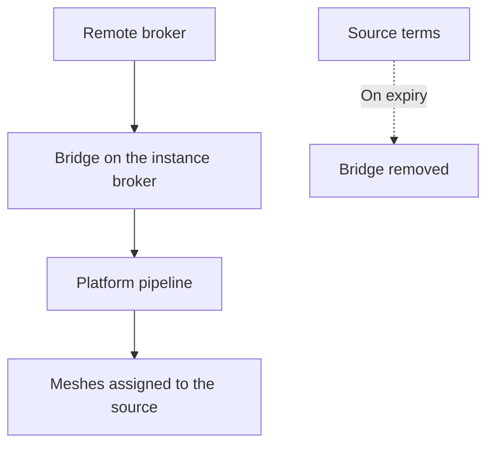

A source is a remote MQTT broker together with a topic filter. The instance broker subscribes to that filter and copies the matching traffic into the platform. Only operators and superusers manage sources: an operator can view the sources they created, and a superuser can view all of them. Other users receive 403, the **Data** menu does not show the page, and opening `/console/sources` directly redirects to the meshes page.

A source imports data from a remote broker. No data is stored until the bridge is established, and the bridge is removed when the source terms expire.

<Callout type="warn" title="A failed bridge stores nothing">
If the bridge cannot be created, the API returns 502 and the source is not saved. When editing, a 502 response means that the stored source is unchanged.
</Callout>

A member requests the operator role from the profile page. See [Accounts](/accounts).

## Registration fields

| Field | Rule |
| --- | --- |
| Label | Optional name shown in the list |
| Server | `host:port` |
| Topic | The topic filter to import. `$share` and `$SYS` are rejected. |
| TLS | Enabled by default |
| Username and password | The password is write-only and is never returned. |
| QoS | 0 or 1. The default is 1. |

Creating a source accepts the current source terms (`GET /sources/terms`) and sends `terms_version`. The operator acts as data controller for the imported traffic, and Sensical acts as data processor. Acceptance constitutes an agreement with the operator, recorded with a hash of the exact text, and is requested on every creation but not on edits. On instances that do not require acceptance of terms, this step is omitted.

## Meshes on a source

When creating or editing a mesh, an operator selects **Default broker** or one of their sources. `source_id: null` denotes the default broker. The list shows the source name on meshes the user owns; meshes owned by other users do not show a source identifier.

A source cannot be deleted while meshes are assigned to it. The deletion dialog lists those meshes with a link to each one, and they must be reassigned first.

## Expiry and renewal

Source terms can expire. On expiry, `paused_at` is set, the bridge is removed, and meshes on the source stop receiving data until the creator renews the terms (`POST /sources/{id}/terms-acceptance`). The list shows the status, and a **Renew** action is available to the creator when the source is paused, close to expiry, or bound to a text that has changed.

When editing the password, the current value can be kept, replaced with a new value, or cleared by sending an empty string. A 502 response on edit means that the bridge was not reconfigured and the stored source is unchanged.

When a source remains above the message rate allowed by the instance, the operator who created it can receive an email notification.
