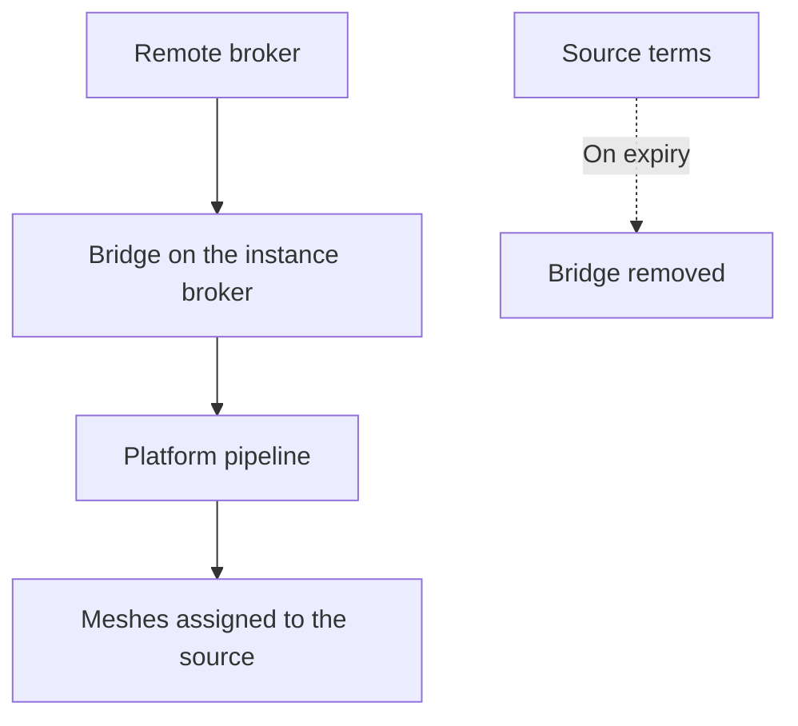

A source is a remote MQTT broker and a topic filter. The instance broker subscribes to that filter and copies the matching traffic into the platform. Only operators and superusers manage sources. An operator sees the sources they created. A superuser sees every source. Anyone else receives 403. The **Data** menu does not show the page, and opening `/console/sources` redirects to the meshes page.

Nothing is stored until the bridge is up. When the source terms expire, the bridge is removed.

<Callout type="warn" title="A failed bridge stores nothing">
If the bridge cannot be created, the API returns 502 and the source is not saved. On edit, a 502 means the stored source is unchanged and the previous bridge is put back. On delete, a 502 means the source is kept.
</Callout>

A member asks for the operator role on the profile page. See [Accounts](/accounts).

## Registration fields

| Field | Rule |
| --- | --- |
| Label | Optional name shown in the list |
| Server | `host:port`. It cannot be this instance's own broker. |
| Topic | The topic filter to import. A filter that starts with `$`, including `$share` and `$SYS`, is rejected. So is a filter that could match the topics this instance uses for sources and sinks. |
| TLS | On by default. The API field is `ssl`. |
| Username and password | The password is write-only and is never returned. A password requires a username. |
| QoS | 0 or 1. The default is 1. |

Creating a source accepts the current source terms (`GET /sources/terms`) and sends `terms_version`. The operator is the data controller for the imported traffic. Sensical is the data processor. Acceptance is an agreement with the operator, stored with a hash of the exact text. It is required on every create, and not on edit. Instances that do not require terms skip this step.

## Meshes on a source

When creating or editing a mesh, an operator chooses **Default broker** or one of their sources. `source_id: null` is the default broker. The list shows the source name on meshes the user owns. Meshes owned by someone else do not show a source id.

A source cannot be deleted while meshes are assigned to it. The API returns 409. The delete dialog lists those meshes, each with a link. Reassign them first.

## Expiry and renewal

Source terms can expire. On expiry, `paused_at` is set, the bridge is removed, and meshes on the source stop receiving data until the creator renews the terms (`POST /sources/{id}/terms-acceptance`). If the bridge cannot restart, renewal returns 502 and the terms stay as they were. The list shows the status. **Renew** is available to the creator when the source is paused, close to expiry, or tied to text that has changed.

On edit, keep the password, replace it, or clear it with an empty string. A 502 on edit means the bridge was not reconfigured and the stored source is unchanged.

If a source stays above the message rate set for the instance, active superusers are emailed. The operator who created it is emailed only when source rate alerts are on. The mail is sent once while the source stays above that rate.
