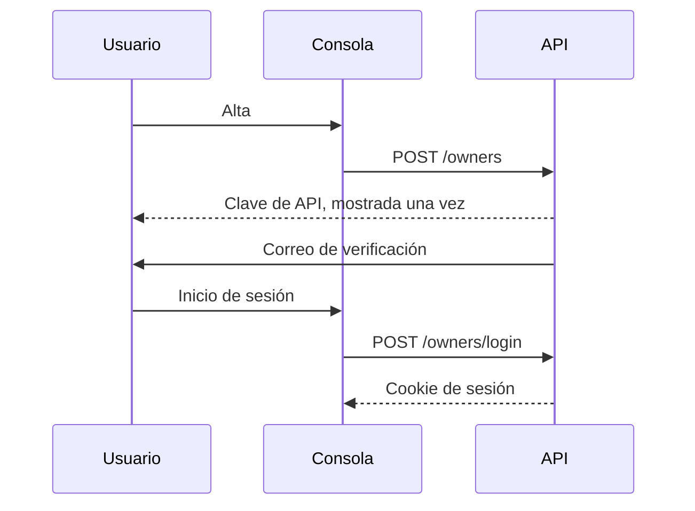

Una cuenta es un **propietario**. La dirección de correo electrónico es el nombre de usuario. `is_active` indica que la dirección de correo se ha verificado.

El alta y la autenticación son operaciones independientes. Los scripts se autentican con una clave de API; la consola se autentica con una cookie de sesión. Ninguna de las dos credenciales se guarda en el navegador para reutilizarla manualmente.

<Callout type="warn" title="La clave de API se muestra una sola vez">
La base de datos almacena únicamente un hash SHA-256 de la clave, por lo que no es posible volver a mostrarla. Al rotar la clave, la anterior deja de ser válida. Si la clave se pierde, es necesario generar una nueva.
</Callout>

## Alta

`POST /owners` crea la cuenta y devuelve una clave de API una sola vez. El formulario de alta de la consola está disponible en `/signup`.

Cuando la instancia exige la aceptación de condiciones, el alta solicita también la aceptación de las condiciones de uso y de la política de privacidad. Las condiciones de la cuenta no caducan; la aceptación solo se solicita de nuevo cuando cambia el texto. En las instancias que no exigen aceptación, este paso se omite, `GET /terms` devuelve 404 y la consola oculta las casillas correspondientes.

Una cuenta no supera las comprobaciones de acceso habituales hasta que se verifica su dirección de correo. El enlace de verificación llama a `GET /owners/verify-email`. Se puede solicitar un nuevo mensaje de verificación con `POST /owners/me/resend-verification`.

## Autenticación

La consola se autentica con una cookie de sesión, mediante `POST /owners/login` y `POST /owners/logout`. Los propietarios sin verificar pueden iniciar sesión para completar la verificación. Los intentos de inicio de sesión están limitados por dirección IP de cliente y por dirección de correo. Los intentos fallidos caducan transcurrido un tiempo y no se acumulan de forma indefinida.

La API de lecturas acepta la misma cookie de sesión que la API de registro.

Los scripts se autentican con la cabecera `Authorization: Bearer` y la clave de API. La clave se rota con `POST /owners/me/rotate-key`, y la nueva clave se muestra una sola vez.

El restablecimiento de la contraseña utiliza un token enviado en el cuerpo de la petición: `POST /owners/request-password-reset`, seguido de `POST /owners/reset-password`. Un propietario con la sesión iniciada cambia la contraseña con `POST /owners/me/change-password`.

## Roles

| Rol | Asignación | Permisos adicionales |
| --- | --- | --- |
| Miembro | Alta | Mallas, dispositivos y plantillas propios |
| Operador | Aprobación de una solicitud por un superusuario | Fuentes, destinos y el archivo |
| Staff | Asignado por la administración de la instancia | Lectura del catálogo, sin secretos ni permisos de escritura |
| Superusuario | Asignado por la administración de la instancia | Acceso a todas las mallas y todas las claves |

El rol de operador se solicita desde **Perfil** con **Solicitar rol de operador**. Cada propietario puede tener una sola solicitud pendiente. Una solicitud rechazada puede presentarse de nuevo. Cuando se aprueba una solicitud, el `role` del propietario pasa a ser `operator`.

## Visibilidad

Un propietario verificado puede leer sus propias mallas y cualquier malla marcada como pública. Un superusuario puede leer todas las mallas. La marca de malla pública nunca concede permisos de escritura.

El staff puede leer el catálogo, pero no puede consultar las PSK. Los operadores solo pueden consultar las fuentes y los destinos que han creado; los superusuarios pueden consultar todos.

## Avisos de alarma

`alarm_email_cooldown_seconds` en `PUT /owners/me` sustituye el valor por defecto de la instancia para el periodo durante el que se retienen las alarmas de un dispositivo antes de enviar un correo de resumen. Un valor nulo aplica el valor por defecto de la instancia. Véase [Calidad y alarmas](/docs/quality).

Otros dos ajustes se refieren a la infraestructura creada por el propietario y no a las alarmas de sensores:

- `status_alerts_enabled` envía un correo cuando una fuente o un destino creados por el propietario permanecen desconectados o sin uso.
- `source_rate_alerts_enabled` envía un correo cuando una fuente creada por el propietario se mantiene por encima de la tasa de mensajes permitida por la instancia.
