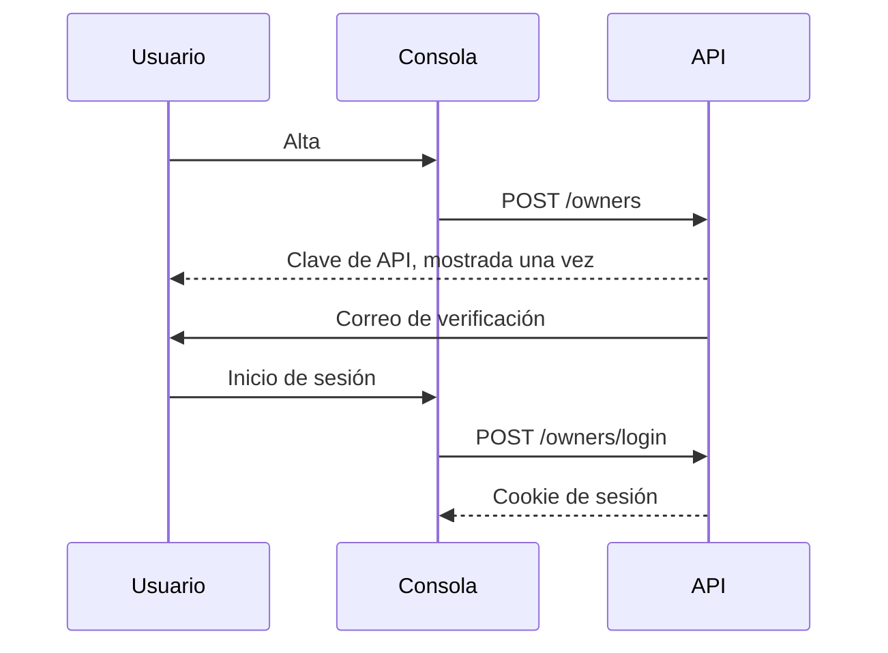

Una cuenta es un **propietario**. La dirección de correo es el nombre de usuario. `is_active` es verdadero cuando esa dirección está verificada.

La consola inicia sesión con una cookie de sesión. Los scripts envían una clave de API. La clave se muestra una sola vez y no se guarda en el navegador.

<Callout type="warn" title="La clave de API se muestra una sola vez">
La base de datos guarda solo un hash SHA-256 de la clave, así que no se puede volver a mostrar. Al rotarla, la anterior deja de valer. Si la pierdes, genera una nueva.
</Callout>

## Alta

`POST /owners` crea la cuenta y devuelve una clave de API una sola vez. El formulario de la consola está en `/signup`.

Cuando la instancia exige condiciones, el alta también te pide aceptar las condiciones de uso y la política de privacidad. Las condiciones de la cuenta no caducan. La aceptación solo se pide de nuevo cuando cambia el texto. En una instancia que no exige aceptación, este paso se omite, `GET /terms` devuelve 404 y la consola oculta las casillas.

Una cuenta no supera las comprobaciones de acceso habituales hasta que se verifica el correo. El enlace del mensaje llama a `GET /owners/verify-email`. Pide otro mensaje con `POST /owners/me/resend-verification`.

## Autenticación

La consola usa una cookie de sesión: `POST /owners/login` y `POST /owners/logout`. Un propietario sin verificar puede iniciar sesión para terminar la verificación. El inicio de sesión se limita por cada pareja de IP del cliente y correo. El límite es una ventana de tiempo, así que los fallos antiguos dejan de contar.

La API de lecturas acepta la misma cookie de sesión que la API de registro.

Los scripts envían `Authorization: Bearer` y la clave de API. Rota la clave con `POST /owners/me/rotate-key`. La nueva clave se muestra una sola vez.

El restablecimiento de la contraseña usa un token en el cuerpo de la petición: `POST /owners/request-password-reset` y después `POST /owners/reset-password`. Un propietario con la sesión iniciada cambia la contraseña con `POST /owners/me/change-password`.

## Roles

| Rol | Asignación | Permisos adicionales |
| --- | --- | --- |
| Miembro | Alta | Mallas, dispositivos y plantillas propios |
| Operador | Un superusuario aprueba la solicitud | Fuentes, destinos y el archivo |
| Staff | Lo asigna la administración de la instancia | Lectura del catálogo, sin secretos ni escritura |
| Superusuario | Lo asigna la administración de la instancia | Todas las mallas y todas las claves |

Pide el rol de operador desde **Perfil** con **Solicitar rol de operador**. Un propietario puede tener una sola solicitud pendiente. Una solicitud rechazada se puede enviar de nuevo. Cuando se aprueba, `role` pasa a `operator`.

## Visibilidad

Un propietario verificado puede leer sus mallas y cualquier malla marcada como pública. Un superusuario puede leer todas las mallas. La marca pública nunca da permiso de escritura.

El staff puede leer el catálogo, pero no puede ver las PSK. Un operador solo ve las fuentes y los destinos que ha creado. Un superusuario los ve todos.

## Avisos de alarma

`alarm_email_cooldown_seconds` en `PUT /owners/me` sustituye el valor por defecto de la instancia: el tiempo que se retienen las alarmas de un dispositivo antes de enviar un correo de resumen. Null usa el valor de la instancia. Véase [Calidad y alarmas](/quality).

Otros dos ajustes se refieren a la infraestructura que ha creado el propietario, no a las alarmas de los sensores:

- `status_alerts_enabled` envía un correo cuando una fuente o un destino creados por el propietario siguen desconectados o sin uso.
- `source_rate_alerts_enabled` envía un correo cuando una fuente creada por el propietario se mantiene por encima de la tasa de mensajes que permite la instancia.
