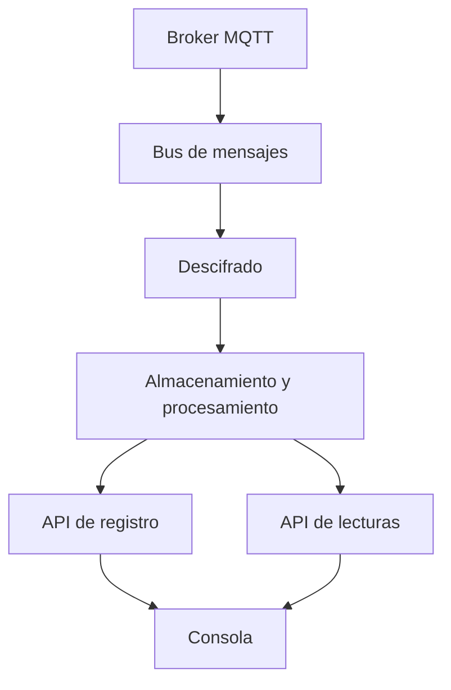

La plataforma es un proceso de ingesta, dos APIs HTTP y la consola. El proceso toma paquetes de MQTT, los descifra y escribe los resultados en los almacenes de datos. Las APIs sirven esos almacenes. La consola se apoya en las APIs.

## Ingesta

Un puente MQTT copia el tráfico del broker de esta instancia, y de las [fuentes](/sources) registradas, a un bus de mensajes interno como paquetes en bruto. El bus separa la ingesta del descifrado, así que una parada breve en las etapas posteriores no pierde paquetes.

## Descifrado

El descifrado lee los paquetes en bruto y busca la clave de la malla por pasarela. Se descartan los paquetes de una pasarela desconocida o de un nodo rechazado. Los paquetes permitidos se descifran y pasan a eventos estructurados: identificador de la malla, identificador del nodo, tipo de contenido y contenido.

En unas instancias el descifrado corre como un servicio ligero. En otras, como un trabajo de procesamiento en flujo. El procesamiento en flujo aplica además la calibración y los detectores en flujo descritos en [Calidad y alarmas](/quality).

## Almacenamiento y procesamiento

Varios componentes independientes consumen los eventos descifrados:

- un escritor que guarda las lecturas en InfluxDB
- consumidores del registro que anotan los avistamientos de dispositivos y descubren los canales de sensores
- un escritor de archivo que guarda ficheros Parquet para los dispositivos que lo activan
- los detectores y los trabajos programados que producen métricas de calidad, canales derivados y alarmas

Véase [Almacenes de datos](/data) para el contenido de cada almacén.

## APIs

Dos APIs HTTP comparten un único punto de entrada público:

- La **API de registro** gestiona cuentas, mallas, dispositivos, el catálogo, plantillas, fuentes y destinos. Usa PostgreSQL.
- La **API de lecturas** sirve series, últimos valores, estadísticas de tráfico, exportaciones y el archivo. Usa InfluxDB.

Las peticiones bajo `/readings/` van a la API de lecturas. El resto va a la API de registro. El documento OpenAPI está en `/schema`. La API de lecturas no tiene acceso a las claves de las mallas.
