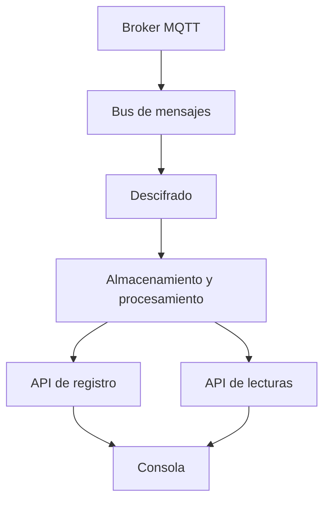

La plataforma consta de un proceso de ingesta, dos APIs HTTP y la consola. El proceso de ingesta recibe paquetes de MQTT, los descifra y escribe los resultados en los almacenes de datos. Las APIs sirven esos almacenes, y la consola se apoya en las APIs.

## Ingesta

Un puente MQTT copia el tráfico del broker de la instancia, y de las [fuentes](/sources) registradas, en un bus de mensajes interno como paquetes en bruto. El bus desacopla la ingesta del descifrado, de modo que una interrupción temporal en las etapas posteriores no provoca la pérdida de paquetes.

## Descifrado

El servicio de descifrado lee los paquetes en bruto y busca la clave de la malla por pasarela. Se descartan los paquetes de una pasarela desconocida o de un nodo rechazado. Los paquetes permitidos se descifran y se convierten en eventos estructurados que contienen el identificador de la malla, el identificador del nodo, el tipo de contenido y el contenido.

Según la instancia, el descifrado se ejecuta como un servicio ligero o como un trabajo de procesamiento en flujo. El procesamiento en flujo aplica además la calibración y los detectores en flujo descritos en [Calidad y alarmas](/quality).

## Almacenamiento y procesamiento

Varios componentes independientes consumen los eventos descifrados:

- un escritor que almacena las lecturas en InfluxDB
- consumidores del registro que anotan los avistamientos de dispositivos y descubren los canales de sensores
- un escritor de archivo que almacena ficheros Parquet para los dispositivos que lo activan
- los detectores y los trabajos programados que producen métricas de calidad, canales derivados y alarmas

Véase [Almacenes de datos](/data) para el contenido de cada almacén.

## APIs

Dos APIs HTTP comparten un único punto de entrada público:

- La **API de registro** gestiona cuentas, mallas, dispositivos, el catálogo, plantillas, fuentes y destinos. Utiliza PostgreSQL.
- La **API de lecturas** sirve series, últimos valores, estadísticas de tráfico, exportaciones y el archivo. Utiliza InfluxDB.

Las peticiones bajo `/readings/` se dirigen a la API de lecturas, y el resto a la API de registro. El documento OpenAPI está disponible en `/schema`. La API de lecturas no tiene acceso a las claves de las mallas.
