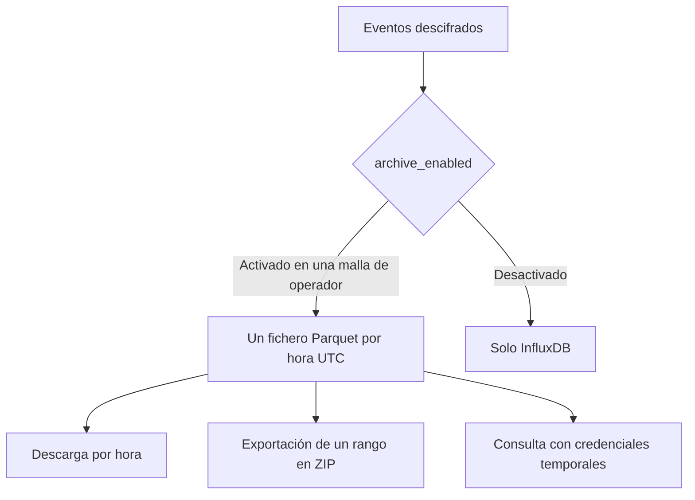

El archivo es una copia a largo plazo de los eventos descifrados, almacenada como ficheros Parquet en almacenamiento de objetos compatible con S3. Está desactivado salvo que un dispositivo lo active. Los gráficos de la consola siguen leyendo de InfluxDB.

El archivo y los gráficos son independientes. Al desactivar el archivo en un dispositivo, se deja de crear ficheros nuevos y se conservan los ya escritos.

<Callout type="info" title="Disponibilidad">
El archivo solo está disponible en las instancias configuradas con almacenamiento de objetos. En el resto de instancias, la lista del archivo devuelve 404 y la consola indica que la función no está disponible.
</Callout>

## Requisitos

`archive_enabled` solo se acepta cuando el propietario de la malla es operador y la instancia dispone de archivo. El propietario y los superusuarios pueden consultar el ajuste; el staff y los lectores públicos no.

La consola denomina este ajuste **Almacenamiento S3**, en el inventario de dispositivos, en las tablas de variantes y en el menú de últimos valores. **Archivo** designa la página, no la retirada de un dispositivo. Al desactivar el ajuste, se deja de crear ficheros nuevos y se conservan los existentes. El dispositivo registra quién modificó el ajuste y cuándo, y un histórico de solo inserción conserva todos los cambios.

## Ficheros

El archivo contiene un objeto por malla y hora UTC:

`{prefix}/mesh_id={uuid}/dt={YYYY-MM-DD}/hour={HH}/data.parquet`

**Datos → Archivo** (`/console/archive`) muestra las mallas del usuario con su número de dispositivos, número de ficheros, tamaño total y última hora archivada. Un superusuario ve también las mallas de otros usuarios que contienen datos archivados. La página de detalle de una malla muestra qué dispositivos están incluidos y, a continuación, los ficheros: una fila por día UTC, del más reciente al más antiguo, que se despliega en una descarga por hora.

Cada descarga horaria redirige al objeto. Un día completo, o un rango más largo, se exporta como un trabajo con `format: parquet`: un fichero ZIP con una carpeta por día que contiene `YYYY-MM-DD/YYYY-MM-DD_HH.parquet`. Se aplican los mismos límites que a las exportaciones CSV: un rango máximo de 366 días, una exportación cada vez y un enlace válido durante 24 horas. Véase [Lecturas](/readings).

## Consultas directas

La página del archivo puede emitir credenciales temporales, que se muestran una sola vez y no pueden revocarse antes de su caducidad. Con esas credenciales, la página ofrece:

- una sentencia `COPY` de DuckDB que combina los ficheros en un único fichero Parquet, o
- un comando `aws s3 sync` que copia las carpetas horarias sin modificarlas

Cuando la instancia no admite credenciales temporales, el endpoint de credenciales devuelve 404 y la página ofrece en su lugar las descargas por fichero. La sentencia de DuckDB utiliza direccionamiento por ruta y configura `USE_SSL` según el endpoint.
