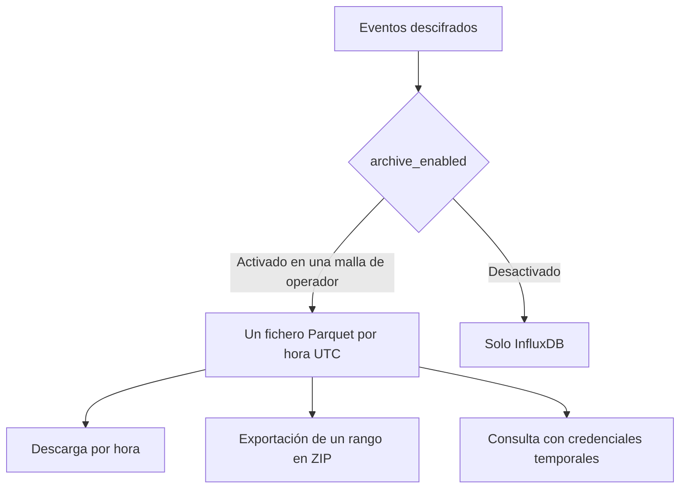

El archivo es una copia a largo plazo de los eventos descifrados, guardada como Parquet en almacenamiento de objetos compatible con S3. Un dispositivo queda fuera hasta que se activa `archive_enabled`. Los gráficos de la consola siguen leyendo de InfluxDB.

El archivo y los gráficos van por separado. Al desactivar el archivo en un dispositivo se dejan de guardar datos nuevos de ese dispositivo y se conservan los ficheros ya escritos.

<Callout type="info" title="Disponibilidad">
El archivo solo funciona en las instancias configuradas con almacenamiento de objetos. En las demás, la lista del archivo devuelve 404 y la consola indica que la función no está disponible.
</Callout>

## Requisitos

`archive_enabled` solo se acepta cuando el propietario de la malla es operador y la instancia tiene archivo. El propietario y los superusuarios pueden ver el ajuste. El staff y los lectores públicos no.

La consola llama a este ajuste **Almacenamiento S3**, en el inventario de dispositivos, en las tablas de variantes y en el menú de últimos valores. **Archivo** es la página, no una forma de retirar un dispositivo. Al desactivar el ajuste se dejan de crear ficheros nuevos de ese dispositivo y se conservan los existentes. El dispositivo registra quién cambió el ajuste y cuándo. Un histórico de solo inserción conserva cada cambio, también después de eliminar el dispositivo.

## Ficheros

Hay un objeto por malla y hora UTC, con los dispositivos que tenían el archivo activado:

`{prefix}/mesh_id={uuid}/dt={YYYY-MM-DD}/hour={HH}/data.parquet`

**Datos → Archivo** (`/console/archive`) muestra las mallas del usuario con el número de dispositivos, el número de ficheros, el tamaño total y la última hora. Un superusuario ve también las mallas de otros propietarios que contienen datos archivados. El detalle de una malla muestra qué dispositivos están incluidos y, después, los ficheros: una fila por día UTC, de la más reciente a la más antigua. Cada fila se abre en una descarga por hora. La API lista las horas de la más antigua a la más reciente. La página las agrupa al revés.

Cada descarga horaria redirige al objeto. Un día completo, o un rango más largo, es un trabajo de exportación con `format: parquet`: un ZIP con una carpeta por día, con el nombre `YYYY-MM-DD/YYYY-MM-DD_HH.parquet`. Se aplican los mismos límites que a las exportaciones CSV: como máximo 366 días, una exportación en cola o en curso por propietario, y un enlace que dura 24 horas. Véase [Lecturas](/readings).

## Consultas directas

La página del archivo puede emitir credenciales temporales. Se muestran una sola vez y no se pueden revocar antes de que caduquen. Siguen siendo válidas hasta `expires_at`, aunque quien las pidió pierda después el acceso a la malla. Con esas credenciales la página ofrece:

- una sentencia `COPY` de DuckDB que junta los ficheros en un único Parquet, o
- un comando `aws s3 sync` que copia las carpetas horarias sin cambiarlas

Cuando la instancia no puede emitir credenciales temporales, el endpoint de credenciales devuelve 404 y la página ofrece las descargas por fichero. Si el endpoint no es AWS, la sentencia de DuckDB usa direccionamiento por ruta. Pone `USE_SSL false` cuando el endpoint es `http://`.
