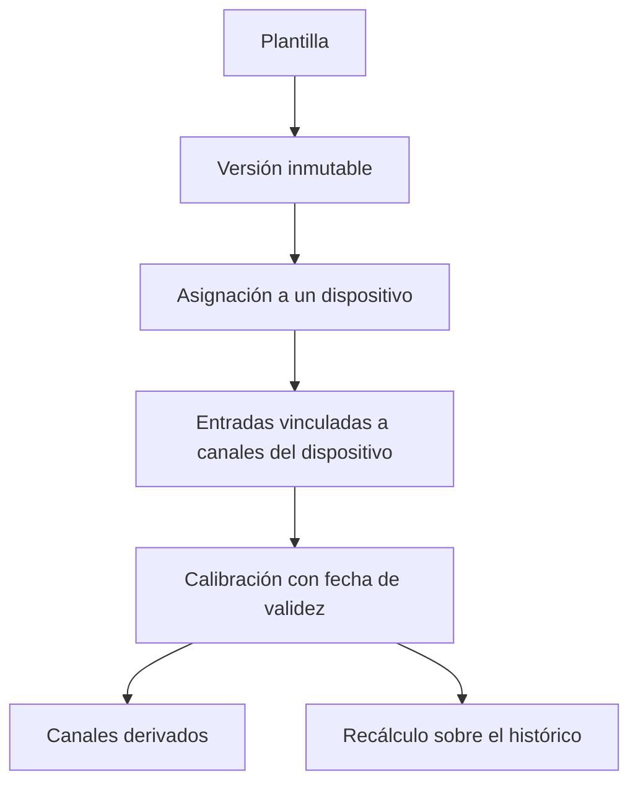

Una plantilla es una lista ordenada de algoritmos con nombre, obtenidos de `GET /algorithms`. Los propietarios editan las plantillas en **Automatización → Plantillas** (`/console/blueprints`). Cada propietario puede consultar sus propias plantillas y todas las plantillas públicas.

Las plantillas y su asignación a dispositivos se versionan de forma independiente, de modo que editar una plantilla no altera los dispositivos que ya la están ejecutando.

<Callout type="info" title="La calibración pertenece al dispositivo">
La plantilla indica el algoritmo. El dispositivo almacena los valores de calibración junto con `valid_from`, de modo que el reprocesamiento de datos históricos aplica la calibración vigente en cada momento.
</Callout>

## Versionado

Los cambios en el nombre, la descripción o la marca de plantilla pública modifican la plantilla directamente. Los cambios en los pasos crean una **nueva versión**, copiada de la más reciente. Los dispositivos se asignan a una versión concreta, por lo que la fórmula aplicada a un dispositivo en ejecución nunca cambia sin una actualización explícita.

Cada paso tiene:

- una clave y una posición, ambas únicas dentro de la versión
- `function_name`, que debe existir en el catálogo de algoritmos
- `inputs`: cada entrada del algoritmo es `slot:<name>` o `step:<key>.<output>`
- `params` para la configuración. Los parámetros marcados como calibración no se establecen aquí.
- `outputs`: cada salida del algoritmo se convierte en el nombre de un campo derivado

Al renombrar una entrada o un paso, se actualizan todas las referencias a ellos. La consola valida las mismas reglas que la API antes de enviar el formulario.

## Asignación a un dispositivo

En la página del dispositivo, un postprocesado asigna una versión de plantilla al dispositivo:

- cada entrada se vincula a un canal del dispositivo
- `output_prefix` se antepone a cada campo derivado, de modo que la misma plantilla puede ejecutarse más de una vez en un dispositivo
- `tolerance_seconds` es la diferencia temporal máxima entre muestras que se consideran simultáneas. Un valor nulo aplica la mitad del intervalo de lectura del dispositivo.
- `is_enabled` inicia y detiene el postprocesado

Los canales derivados aparecen como mediciones cuyo campo `produced_by` hace referencia al postprocesado. El tipo de catálogo de un canal derivado se elimina cuando se elimina el último canal que lo utiliza, de modo que una unidad obsoleta no puede bloquear una asignación posterior.

## Calibración

La calibración se almacena en el dispositivo, no en la plantilla. Los registros `StepCalibration` solo admiten inserciones y contienen la clave del paso, el nombre del algoritmo, los parámetros y `valid_from`. El reprocesamiento de datos históricos aplica la calibración vigente en el momento de cada muestra. Una calibración solo se aplica mientras el paso utiliza el mismo algoritmo.

Si una función de calibración falla con una lectura, el error se registra y el valor en bruto se transmite sin cambios.

## Recálculo

Un recálculo (`POST` sobre el postprocesado) vuelve a ejecutar la plantilla sobre un intervalo de tiempo almacenado. `include_dependants` vuelve a ejecutar también, en orden, los postprocesados que leen las salidas de este. El estado pasa por `pending`, `running`, `done` y `failed`, y el registro almacena el número de puntos publicados.

Un recálculo carga los canales necesarios en el intervalo seleccionado, los alinea con el intervalo de lectura, ejecuta los pasos en orden y escribe los resultados en la medición `derived`, etiquetados con la plantilla. Los algoritmos puntuales también pueden ejecutarse sobre cada muestra entrante; los algoritmos por ventana solo se ejecutan como trabajos programados.
