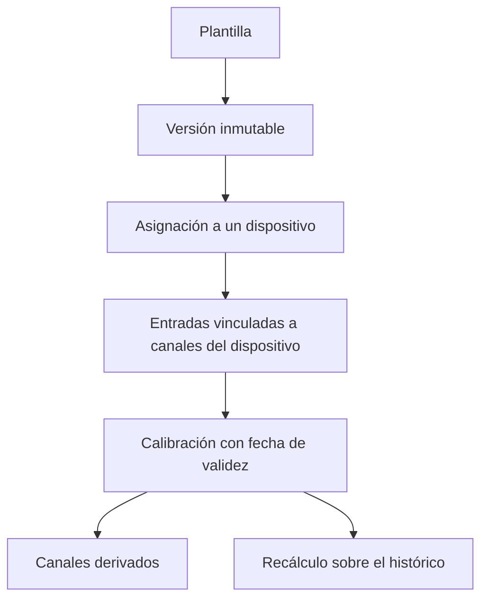

Una plantilla es una lista ordenada de algoritmos con nombre, de `GET /algorithms`. Los propietarios las editan en **Automatización → Plantillas** (`/console/blueprints`). Cada propietario ve las suyas y todas las públicas.

Las plantillas y su asignación a dispositivos se versionan por separado. Editar una plantilla no cambia los dispositivos que ya la ejecutan.

<Callout type="info" title="La calibración pertenece al dispositivo">
La plantilla nombra el algoritmo. El dispositivo guarda los valores de calibración con `valid_from`. Al reprocesar el histórico se usa la calibración vigente en cada muestra.
</Callout>

## Versionado

Un cambio de nombre, descripción o marca de plantilla pública actualiza la plantilla en el sitio. Un cambio de pasos crea una **versión nueva**, copiada de la más reciente. Un dispositivo se asigna a una versión concreta, así que la fórmula de un dispositivo en marcha cambia solo cuando actualizas esa asignación.

Cada paso tiene:

- una clave y una posición, ambas únicas dentro de la versión
- `function_name`, que debe existir en el catálogo de algoritmos
- `inputs`: cada entrada del algoritmo es `slot:<name>` o `step:<key>.<output>`
- `params` para la configuración. Los parámetros marcados como calibración no se ponen aquí.
- `outputs`: cada salida del algoritmo pasa a ser el nombre de un campo derivado

Al renombrar una entrada o un paso se actualizan todas las referencias. La consola comprueba las mismas reglas que la API antes de enviar el formulario.

## Asignación a un dispositivo

En la página del dispositivo, un postprocesado asigna una versión de plantilla al dispositivo:

- cada entrada se vincula a un canal del dispositivo
- `output_prefix` se antepone a cada campo derivado, así la misma plantilla puede ejecutarse más de una vez en un dispositivo
- `tolerance_seconds` es la separación máxima entre muestras que se tratan como simultáneas. Nulo usa la mitad del intervalo de lectura del dispositivo, o 30 segundos si el dispositivo no tiene intervalo.
- `is_enabled` arranca y detiene el postprocesado

Los canales derivados son mediciones cuyo campo `produced_by` apunta al postprocesado. Cuando se borra el último canal que usa un tipo de catálogo derivado, ese tipo también se borra, y una unidad antigua no bloquea una asignación posterior.

## Calibración

La calibración se guarda en el dispositivo, no en la plantilla. Las filas `StepCalibration` solo se añaden. Cada una tiene la clave del paso, el nombre del algoritmo, los parámetros y `valid_from`. Al reprocesar el histórico se aplica la calibración vigente en cada muestra. Una calibración solo vale mientras el paso siga usando ese algoritmo.

Si un paso falla con una lectura, se registra el error y esa lectura no produce valor derivado.

## Recálculo

Un recálculo (`POST` sobre el postprocesado) vuelve a ejecutar la plantilla sobre lecturas ya guardadas. `stop` vale ahora si no lo indicas. El intervalo cubre como máximo 90 días. El postprocesado tiene que ser válido. No hace falta que esté activado. `include_dependants` vuelve a ejecutar también, en orden de dependencia, los postprocesados activados que leen las salidas de este. El estado pasa por `pending`, `running`, `done` y `failed`. El registro guarda el número de puntos publicados. Los valores recalculados se guardan. No generan alarmas.

Un recálculo carga los canales del intervalo, junta las muestras dentro de `tolerance_seconds`, ejecuta los pasos en orden y escribe la medición `derived`, etiquetada con el postprocesado. Los algoritmos puntuales también pueden ejecutarse con cada muestra entrante. Los algoritmos por ventana solo se ejecutan como trabajos programados.
