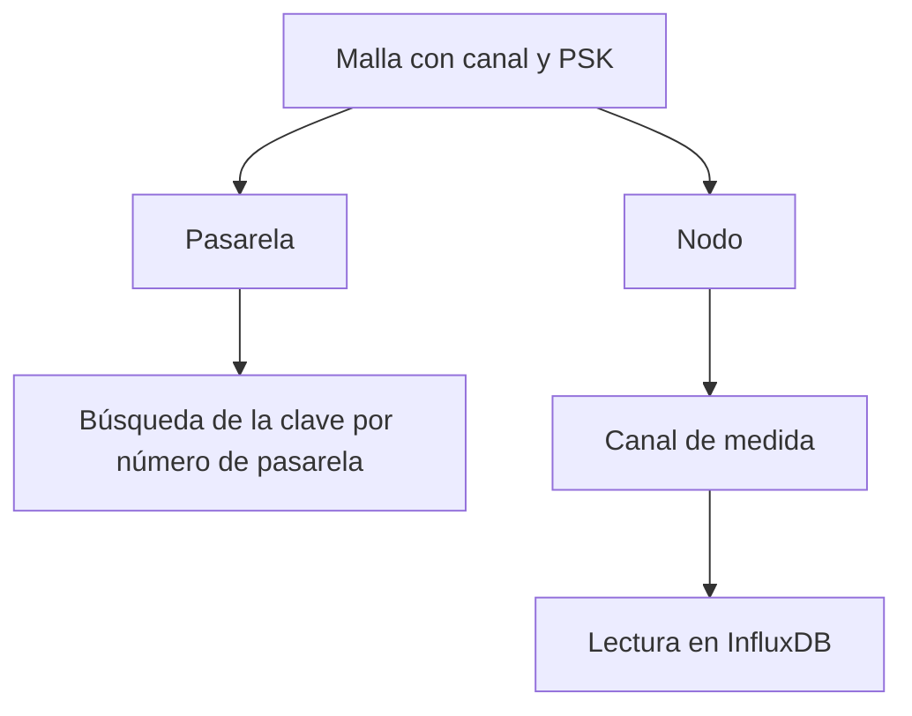

## Malla

Una malla es una red Meshtastic física. El siguiente diagrama muestra la relación entre las entidades principales.

<Callout type="info" title="Dos significados de canal">
El canal de Meshtastic es el nombre del canal de radio junto con su clave. Un canal de medida es una única magnitud informada por un único dispositivo, como `environment_metrics.temperature`. En esta documentación, canal se refiere a un canal de medida salvo que se indique expresamente el canal de radio.
</Callout>

Una malla tiene un nombre de canal y una clave precompartida (PSK). El servicio de descifrado utiliza este par para convertir los paquetes en lecturas. Una vez almacenada, la PSK es de solo escritura en la API: el propietario puede consultarla en la consola, y la API de lecturas no la expone nunca.

Una malla es **pública** cuando cualquier propietario verificado, así como un cliente de la API sin autenticar, puede leer sus dispositivos y lecturas. El acceso público nunca se extiende a las operaciones de escritura. Solo el propietario o un superusuario pueden modificar la malla, rechazar un nodo o consultar los nodos rechazados.

El tráfico se recibe en el broker propio de la instancia o a través de una [fuente](/docs/sources): un broker y un topic remotos que importa un operador.

## Pasarela y nodo

Un **dispositivo** es una radio Meshtastic, registrada como pasarela o como nodo.

- Una **pasarela** publica paquetes en MQTT. El servicio de descifrado identifica la clave de la malla por el número de nodo de la pasarela, por lo que el número de nodo de una pasarela permitida debe ser único en toda la instancia.
- Un **nodo** es cualquier otra radio de la malla. El mismo número de nodo puede existir en dos mallas, por ejemplo cuando dos fuentes reciben la misma radio.

El número de nodo es el identificador de Meshtastic. La consola lo muestra en el formato hexadecimal que utilizan los clientes de Meshtastic. El identificador de registro, un UUID, es el que utiliza la API para el registro del dispositivo.

Con `is_allowed = false` se rechaza un dispositivo, y el servicio de descifrado descarta sus paquetes. El rechazo no elimina el dispositivo: el registro se conserva para que el dispositivo pueda volver a permitirse.

## Canal

El término canal tiene dos significados distintos.

- El **canal de Meshtastic** es el nombre del canal de radio junto con la PSK. Pertenece a la malla.
- Un **canal de medida** es una única magnitud informada por un único dispositivo, con el nombre `measurement.field`. Por ejemplo, `environment_metrics.temperature` es un canal de medida. Las plantillas, las comprobaciones de calidad y las lecturas almacenadas hacen referencia a los canales por este nombre.

Una **variante de telemetría** es un tipo de mensaje protobuf, como `telemetry:environment_metrics`, o un tipo fijo, como `device:position`. El catálogo indica qué magnitudes puede producir cada variante. Cuando un dispositivo informa por primera vez de una variante, la plataforma crea los canales correspondientes para ese dispositivo.

## Lectura

Una lectura es una única muestra numérica, almacenada en InfluxDB con el identificador de la malla y el identificador del nodo. Los canales derivados, las métricas de calidad y las alarmas también se almacenan como lecturas, con sus propios nombres de medición. Véase [Almacenes de datos](/docs/data).

## Roles

| Rol | Permisos |
| --- | --- |
| Miembro (propietario) | Crear y gestionar mallas y dispositivos propios. Leer mallas públicas. Solicitar el rol de operador. |
| Operador | Todos los permisos de miembro, además de fuentes, destinos y el archivo Parquet en las mallas propias. |
| Staff | Lectura del catálogo. Sin acceso a las PSK y sin permisos de escritura. |
| Superusuario | Lectura y escritura en todas las mallas, incluidas las claves. |

Un operador sigue siendo propietario de sus mallas. Los permisos adicionales se refieren a la ingesta compartida y a la publicación de datos para terceros.

## Fuente y destino

Una **fuente** importa datos. Es un broker MQTT remoto cuyos topics coincidentes se copian en la instancia.

Un **destino** exporta datos. Es un conjunto de credenciales en el broker de la instancia. Un consumidor externo se suscribe con esas credenciales y recibe los flujos que ha seleccionado el operador: lecturas descifradas, canales derivados, alarmas o cualquier combinación de ellos.

El archivo es un mecanismo de exportación distinto: ficheros Parquet por horas en almacenamiento de objetos, que se activa por dispositivo.
