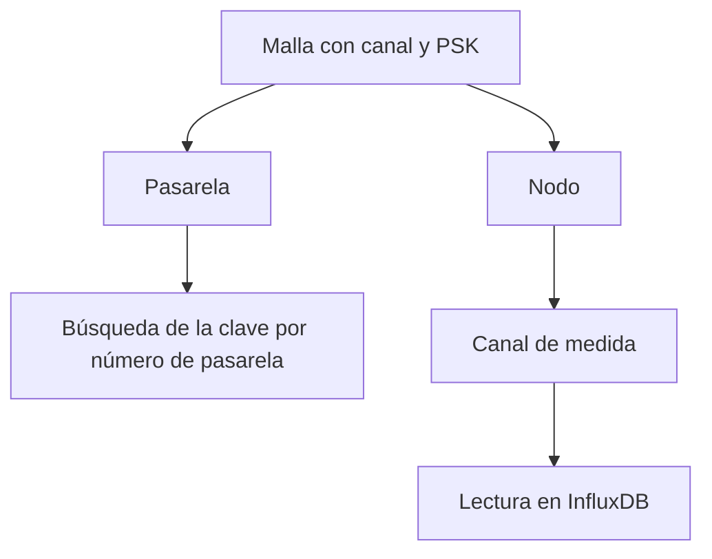

## Malla

Una malla es una red Meshtastic física. El diagrama muestra cómo se relacionan las entidades principales.

<Callout type="info" title="Dos significados de canal">
El canal de Meshtastic es el nombre del canal de radio junto con su clave. Un canal de medida es una magnitud de un dispositivo, como `environment_metrics.temperature`. En esta documentación, canal significa un canal de medida salvo que se nombre el canal de radio.
</Callout>

Una malla tiene un nombre de canal y una clave precompartida (PSK). El descifrado usa ese par para convertir los paquetes en lecturas. Una vez guardada, la PSK es de solo escritura en la API: el propietario puede verla en la consola, y la API de lecturas no la devuelve nunca.

Una malla es **pública** cuando cualquier propietario verificado, y un cliente de la API sin autenticar, puede leer sus dispositivos y lecturas. El acceso público no incluye escrituras. Solo el propietario o un superusuario pueden cambiar la malla, rechazar un nodo o ver los nodos rechazados.

El tráfico llega al broker de esta instancia o por una [fuente](/sources): un broker y un topic remotos que importa un operador.

## Pasarela y nodo

Un **dispositivo** es una radio Meshtastic, registrada como pasarela o como nodo.

- Una **pasarela** publica paquetes en MQTT. El descifrado localiza la clave de la malla por el número de nodo de la pasarela, así que el número de nodo de una pasarela permitida debe ser único en la instancia.
- Un **nodo** es cualquier otra radio de la malla. El mismo número de nodo puede existir en dos mallas, por ejemplo cuando dos fuentes reciben la misma radio.

El número de nodo es el identificador de Meshtastic. La consola lo muestra en el hexadecimal que usan los clientes de Meshtastic. El identificador de registro, un UUID, es el que usa la API para el registro del dispositivo.

`is_allowed = false` rechaza un dispositivo, y el descifrado descarta sus paquetes. El rechazo no borra el dispositivo. El registro se conserva para poder permitirlo de nuevo.

## Canal

Canal tiene dos significados.

- El **canal de Meshtastic** es el nombre del canal de radio junto con la PSK. Pertenece a la malla.
- Un **canal de medida** es una magnitud de un dispositivo, con el nombre `measurement.field`. `environment_metrics.temperature` es un canal de medida. Las plantillas, las comprobaciones de calidad y las lecturas guardadas nombran los canales así.

Una **variante de telemetría** es un tipo de mensaje protobuf, como `telemetry:environment_metrics`, o un tipo fijo, como `device:position`. El catálogo indica qué magnitudes puede producir cada variante. La primera vez que un dispositivo informa de una variante, la plataforma crea los canales que le corresponden.

## Lectura

Una lectura es una muestra numérica, guardada en InfluxDB con el identificador de la malla y el del nodo. Los canales derivados, las métricas de calidad y las alarmas también se guardan como lecturas, con sus propios nombres de medición. Véase [Almacenes de datos](/data).

## Roles

| Rol | Permisos |
| --- | --- |
| Miembro (propietario) | Crear y gestionar mallas y dispositivos propios. Leer mallas públicas. Solicitar el rol de operador. |
| Operador | Todos los permisos de miembro, además de fuentes, destinos y el archivo Parquet en las mallas propias. |
| Staff | Lectura del catálogo. Sin acceso a las PSK y sin permisos de escritura. |
| Superusuario | Lectura y escritura en todas las mallas, incluidas las claves. |

Un operador sigue siendo propietario de sus mallas. Los permisos extra cubren la ingesta compartida y la publicación de datos para otras partes.

## Fuente y destino

Una **fuente** importa datos. Es un broker MQTT remoto. Los topics que coinciden se copian en esta instancia.

Un **destino** exporta datos. Es un conjunto de credenciales en el broker de esta instancia. Un consumidor externo se suscribe con esas credenciales y recibe los flujos que eligió el operador: lecturas descifradas, canales derivados, alarmas o cualquier combinación.

El archivo es una exportación aparte: ficheros Parquet por horas en almacenamiento de objetos, activado por dispositivo.
