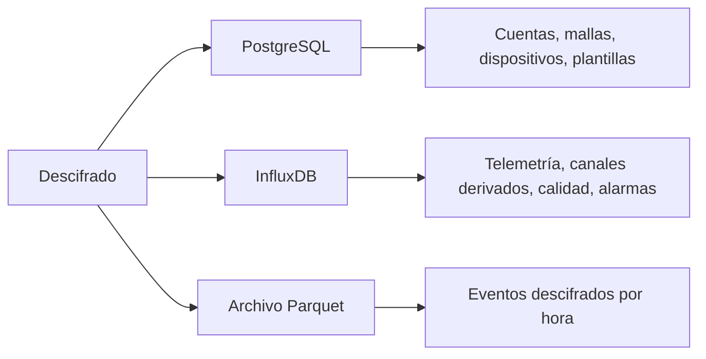

La plataforma almacena los datos en tres lugares. PostgreSQL contiene el registro de cuentas y dispositivos. InfluxDB contiene las mediciones. El archivo Parquet contiene una copia a largo plazo de los eventos descifrados de los dispositivos que lo activan.

<Callout type="info" title="Claves de las mallas">
Las claves de las mallas se almacenan únicamente en el registro. La API de lecturas no puede leerlas.
</Callout>

## PostgreSQL

PostgreSQL contiene el registro: cuentas, mallas, dispositivos, el catálogo de telemetría, plantillas, fuentes y destinos. También registra las condiciones aceptadas y las eliminaciones de datos programadas.

Las relaciones principales son las siguientes. Un propietario tiene cualquier número de mallas y plantillas. Una malla tiene cualquier número de dispositivos. Un dispositivo tiene cualquier número de canales de medida y postprocesados. Una plantilla pública puede asignarla un propietario que no es su autor, pero solo su propietario puede editarla.

Cada tipo de medición del catálogo tiene un tipo de magnitud: `physical_property`, `concentration`, `count`, `ratio` u `other`. Un `vocabulary_uri` opcional hace referencia a un concepto de QUDT o EIONET.

## InfluxDB

Un canal se denomina `measurement.field`. `payload_kind` tiene siempre la forma `namespace:measurement`, y la parte de la medición es el nombre de la medición en InfluxDB.

| Espacio de nombres | Medición | Origen | Campos habituales |
| --- | --- | --- | --- |
| `telemetry` | Nombre de la variante protobuf (`environment_metrics`, …) | Medido | Campos numéricos de ese mensaje |
| `device` | `position` | Dispositivo | `latitude`, `longitude`, `altitude` |
| `device` | `nodeinfo` | Dispositivo | `user_id`; etiquetas para el nombre largo, el nombre corto, el hardware y el rol |
| `computed` | `derived` | Plantilla | Salidas, etiquetadas con `blueprint_id` |
| `computed` | `quality` | Comprobación de completitud | Proporción de datos y métricas de huecos |
| `computed` | `alarms` | Detectores | `message` y un `value` opcional |

Los puntos de telemetría llevan las etiquetas `mesh_id` y `node_id`, y opcionalmente `channel_id` y `gateway_id`. Todos los puntos llevan además `packet_id` y `timestamp_quality` (`rx_time` o `payload`). Los puntos de alarma se etiquetan con `detector`, `mesh_id`, `node_id`, un `channel` opcional y `source` (`stream` o `batch`).

Los mensajes de texto y los paquetes de enrutamiento no se almacenan.

## Parquet

El archivo contiene un objeto por malla y hora UTC. Las columnas incluyen `node_id`, `packet_id`, `portnum`, `rx_time`, `hop_start`, `channel_id`, `gateway_id`, `payload_kind` y `payload_json`. Cuando se reescribe una partición, las filas se deduplican por `(node_id, packet_id, rx_time, payload_kind)`.

Solo se archivan los dispositivos con `archive_enabled`. Véase [Archivo](/docs/archive).
