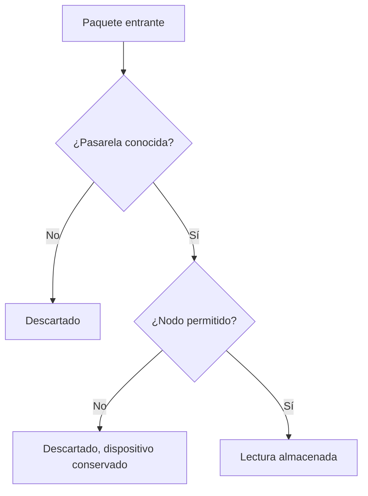

Un dispositivo se registra con `POST /devices` desde la página de la malla, indicando el número de nodo de Meshtastic, si el dispositivo es una pasarela y una etiqueta opcional. El servicio de descifrado también registra los dispositivos de los paquetes que ya puede descifrar, y el descubrimiento de pasarelas puede registrar pasarelas cuando la malla lo permite.

El servicio de descifrado aplica dos comprobaciones antes de almacenar un paquete. Un paquete que no supera alguna de ellas se descarta.

<Callout type="info" title="Rechazar no es eliminar">
`is_allowed = false` indica a todos los servicios de descifrado que descarten los paquetes del nodo. El registro del dispositivo se conserva, por lo que el dispositivo puede volver a permitirse. Los lectores públicos no pueden consultar los dispositivos rechazados.
</Callout>

El inventario de `/console/devices` muestra todos los dispositivos a los que el usuario tiene acceso. Puede filtrarse por malla, pasarela, estado de permiso y plantilla asociada. Cada fila abre la página del dispositivo.

## Pasarela o nodo

`is_gateway` identifica al publicador MQTT. El servicio de descifrado utiliza el número de nodo de la pasarela para encontrar la PSK, por lo que dos pasarelas permitidas no pueden compartir número de nodo en toda la instancia. Los nodos ordinarios solo deben ser únicos dentro de su malla.

En un dispositivo pueden almacenarse hasta tres claves de administración de Meshtastic (`admin_keys_b64`), en línea con el límite del firmware de tres entradas `admin_key`. Solo el propietario de la malla puede consultarlas.

## Dispositivos permitidos y rechazados

Cuando se establece `is_allowed = false`, el servicio de descifrado descarta los paquetes del dispositivo. El dispositivo permanece en el registro y puede volver a permitirse. Los lectores públicos no pueden consultar los dispositivos rechazados.

## Identidad y ubicación

Los paquetes NodeInfo actualizan `name`, `short_name`, `hardware_type` y `role` hasta que se establece `nodeinfo_overridden`. Los paquetes de posición actualizan la latitud y la longitud hasta que se establece `location_overridden`. Una vez establecida la marca, los paquetes posteriores dejan de sobrescribir los valores introducidos manualmente.

`last_seen` registra la última vez que el servicio de descifrado recibió un paquete del dispositivo. `discovered_at` se informa cuando el registro del dispositivo lo creó el descubrimiento de pasarelas.

## Intervalos

`reading_interval_seconds` es el intervalo de muestreo esperado del sensor. Los detectores y la alineación de las plantillas utilizan este valor. `publish_interval_seconds` es el intervalo de transmisión esperado de la radio; el detector de ausencia compara con él los periodos sin transmisiones.

Ambos valores pueden dejarse vacíos cuando todavía no se conocen. La variante de telemetría del catálogo puede aportar un intervalo de lectura por defecto hasta que el dispositivo tenga el suyo.

## Canales del dispositivo

La página del dispositivo muestra las variantes de telemetría (`GET /devices/{id}/telemetry-variants`) y los canales activos (`GET /devices/{id}/measurements`). Un canal se crea cuando se recibe su variante por primera vez; los canales como `environment_metrics.temperature` nunca se crean manualmente.

Cada canal admite los siguientes ajustes:

- `enabled_detectors = null` hereda el valor por defecto del catálogo.
- `enabled_detectors = []` desactiva los detectores del canal.
- `valid_min` y `valid_max` se establecen conjuntamente para el detector de rango. Si ambos están vacíos, el rango no se comprueba.

La detección de ausencia no se configura por canal. Se activa con `absence_detection_enabled` en el dispositivo. Véase [Calidad y alarmas](/quality).

## Archivo

`archive_enabled` incluye el dispositivo en el archivo Parquet. La API solo acepta este ajuste en una malla cuyo propietario es operador, y solo cuando la instancia dispone de archivo. Al desactivarlo, se deja de crear ficheros nuevos y se conservan los ya escritos. La consola denomina este ajuste **Almacenamiento S3**. Véase [Archivo](/archive).
