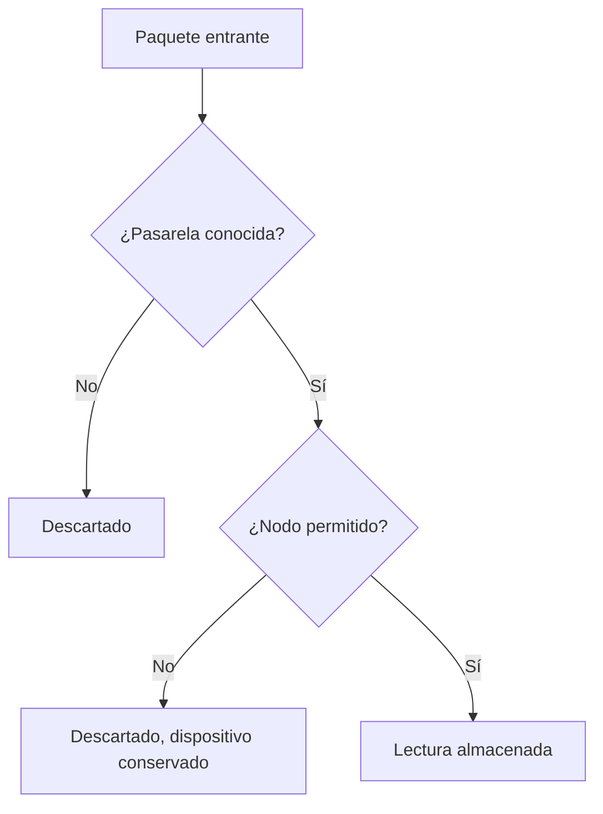

Registra un dispositivo con `POST /devices` desde la página de la malla: el número de nodo de Meshtastic, si es una pasarela y una etiqueta opcional. El servicio de descifrado también registra dispositivos a partir de los paquetes que ya puede descifrar. El descubrimiento de pasarelas puede registrar pasarelas cuando la malla lo permite.

El servicio de descifrado comprueba dos cosas antes de guardar un paquete. Un paquete que no supera alguna de las dos se descarta.

<Callout type="info" title="Rechazar no es eliminar">
`is_allowed = false` indica a todos los servicios de descifrado que descarten los paquetes de ese nodo. El registro del dispositivo se conserva, así que puedes volver a permitirlo. Los lectores públicos no pueden ver los dispositivos rechazados.
</Callout>

El inventario de `/console/devices` lista todos los dispositivos a los que tienes acceso. Filtra por malla, pasarela, estado de permiso y plantilla asociada. Cada fila abre la página del dispositivo.

## Pasarela o nodo

`is_gateway` marca al publicador MQTT. El servicio de descifrado usa el número de nodo de la pasarela para encontrar la PSK, así que dos pasarelas permitidas no pueden compartir número de nodo en toda la instancia. Los nodos ordinarios solo tienen que ser únicos dentro de su malla.

Un dispositivo puede guardar hasta tres claves de administración de Meshtastic (`admin_keys_b64`), el mismo límite que tres entradas `admin_key` en el firmware. El propietario de la malla y un superusuario pueden verlas.

## Dispositivos permitidos y rechazados

Pon `is_allowed = false` para rechazar un dispositivo. El servicio de descifrado descarta sus paquetes. El dispositivo sigue en el registro, y puedes volver a permitirlo. Los lectores públicos no pueden ver los dispositivos rechazados.

## Identidad y ubicación

Los paquetes NodeInfo actualizan `name`, `short_name`, `hardware_type` y `role` hasta que se establece `nodeinfo_overridden`. Los paquetes de posición actualizan la latitud y la longitud hasta que se establece `location_overridden`. Cuando la marca está puesta, los paquetes posteriores ya no sobrescriben los valores que introdujiste.

`last_seen` es la última vez que el servicio de descifrado recibió un paquete del dispositivo. `discovered_at` se informa cuando el descubrimiento de pasarelas creó el registro.

## Intervalos

`reading_interval_seconds` es cada cuánto esperas que muestree el sensor. Los detectores y la alineación de las plantillas lo usan. `publish_interval_seconds` es cada cuánto esperas que transmita la radio. El detector de ausencia compara el silencio con ese valor.

Deja cualquiera de los dos vacío si todavía no lo sabes. La variante de telemetría del catálogo puede dar un intervalo de lectura por defecto hasta que el dispositivo tenga el suyo.

## Canales del dispositivo

La página del dispositivo lista las variantes de telemetría (`GET /devices/{id}/telemetry-variants`) y los canales activos (`GET /devices/{id}/measurements`). Un canal se crea la primera vez que se recibe su variante. Los canales como `environment_metrics.temperature` nunca se crean a mano.

Cada canal tiene estos ajustes:

- `enabled_detectors = null` hereda el valor por defecto del catálogo.
- `enabled_detectors = []` apaga los detectores de ese canal.
- `valid_min` y `valid_max` se establecen juntos para el detector de rango. Si ambos están vacíos, el rango no se comprueba.

La detección de ausencia no se configura por canal. Actívala con `absence_detection_enabled` en el dispositivo. Véase [Calidad y alarmas](/quality).

## Archivo

`archive_enabled` incluye el dispositivo en el archivo Parquet. La API solo acepta este ajuste en una malla cuyo propietario es operador, y solo cuando la instancia tiene archivo. Al desactivarlo se dejan de crear ficheros nuevos y se conservan los ya escritos. La consola llama a este ajuste **Almacenamiento S3**. Véase [Archivo](/archive).
