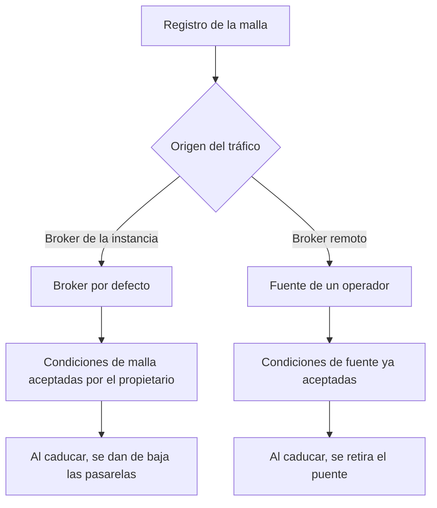

Registra una malla con `POST /meshes`: un identificador de canal, una PSK y una etiqueta opcional. La clave se envía a los servicios de descifrado, así que los paquetes se descifran sin llamar a la API por cada uno.

El origen del tráfico decide qué condiciones se aplican y qué ocurre cuando caducan.

<Callout type="warn" title="El acceso público es de solo lectura">
`is_public` permite a otros propietarios y a los clientes de la API sin autenticar leer los dispositivos y el histórico. No les permite cambiar la malla, ver la PSK ni ver los nodos rechazados.
</Callout>

La consola lista tus mallas en `/console/meshes`. La página de la malla muestra juntas sus pasarelas y sus nodos.

## Control de acceso

| Acción | Permitida para |
| --- | --- |
| Leer dispositivos y lecturas | El propietario, un superusuario y cualquier cliente cuando `is_public` está activado. Los clientes de la API sin autenticar solo pueden leer mallas públicas. |
| Ver la PSK | El propietario y un superusuario. El staff y los lectores públicos no pueden verla. |
| Ver los nodos rechazados | El propietario y un superusuario. |
| Editar o eliminar la malla, registrar dispositivos | El propietario y un superusuario. |

## Origen del tráfico

`source` es nulo cuando los paquetes llegan al broker propio de la instancia. Un operador puede asociar la malla a una de sus [fuentes](/sources). Retirar una malla de una fuente, o eliminar la malla, programa la eliminación de sus lecturas almacenadas tras un periodo de gracia.

En el broker por defecto se aplican las condiciones de la malla, y el propietario es el responsable del tratamiento de ese tráfico. En una fuente se aplican las condiciones de la fuente, y el formulario de la malla no vuelve a pedir la aceptación. Cuando las condiciones caducan:

- En el broker por defecto, la malla se pausa, sus pasarelas se dan de baja y sus lecturas se programan para eliminación, hasta que el propietario renueva las condiciones.
- En una fuente, se retira el puente de esa fuente y las lecturas de sus mallas se programan para eliminación, hasta que el operador renueva las condiciones.

La columna de estado muestra primero el estado más urgente: Eliminación programada, Fuente en pausa, Fuente desconectada, Condiciones modificadas, Renovar pronto, Condiciones no aceptadas, Estado de la fuente desconocido y, al final, Activa. En una instancia que no exige condiciones, una malla en el broker por defecto se muestra como Activa. Una malla en una fuente sigue al puente: en pausa, desconectada, desconocida o activa.

## Descubrimiento de pasarelas

`discover_gateways` registra las pasarelas cuyos paquetes se descifran con el canal y la PSK de esta malla, sin que tengas que añadir cada pasarela a mano. El descubrimiento se limita a unas 50 pasarelas por minuto, para que un broker con mucho tráfico no sature el registro. Los nodos que hay detrás de una pasarela descubierta se registran a medida que se descifran sus paquetes.

Un dispositivo creado así tiene `discovered_at` informado. Puedes rechazarlo como cualquier otro dispositivo.

Solo un operador puede activar el descubrimiento en una malla con una PSK por defecto o vacía. Esa clave coincide con todas las pasarelas del canal.

## Mallas públicas

Activa `is_public` cuando otras personas necesitan leer la flota y su histórico. Los lectores públicos no pueden cambiar la malla, ver la PSK ni ver los dispositivos rechazados.

## Eliminación de una malla

Eliminar una malla no borra sus lecturas en la misma petición. Se programa un trabajo de eliminación de datos con el motivo `mesh_deleted`, que se ejecuta después de `delete_after`. También se programa un trabajo cuando una malla se retira de su fuente (`source_detached`), cuando caducan las condiciones de la malla en el broker por defecto (`terms_lapsed`) o cuando caducan las condiciones de la fuente (`terms_lapsed`, con esa fuente). Renovar las condiciones, o volver a asociar la malla a la misma fuente, puede cancelar un trabajo pendiente.
