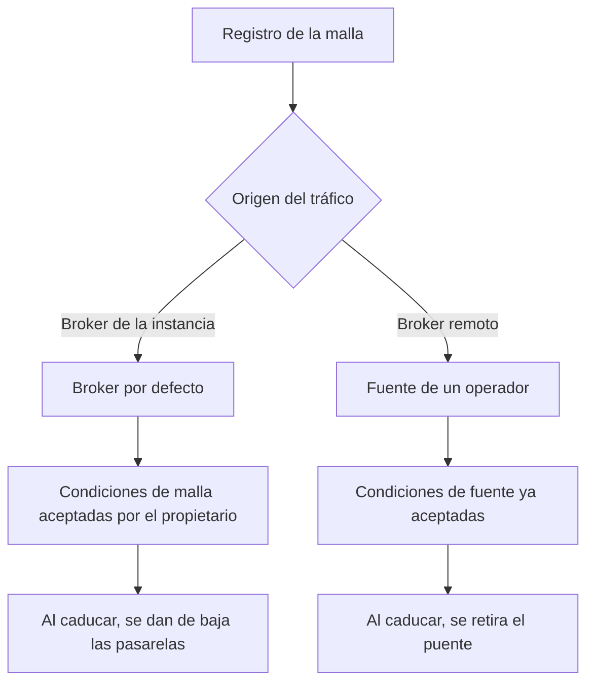

Una malla se registra con `POST /meshes`, indicando un identificador de canal, una PSK y una etiqueta opcional. La clave se distribuye a los servicios de descifrado, de modo que los paquetes se descifran sin consultar la API para cada uno de ellos.

El origen del tráfico determina qué condiciones se aplican y qué ocurre cuando esas condiciones caducan.

<Callout type="warn" title="El acceso público es de solo lectura">
`is_public` permite a otros propietarios y a los clientes de la API sin autenticar leer los dispositivos y el histórico. No les permite modificar la malla, consultar la PSK ni consultar los nodos rechazados.
</Callout>

La consola muestra las mallas del propietario en `/console/meshes`. La página de detalle de una malla muestra sus pasarelas y nodos en conjunto.

## Control de acceso

| Acción | Permitida para |
| --- | --- |
| Leer dispositivos y lecturas | El propietario, un superusuario y cualquier cliente cuando `is_public` está activado. Los clientes de la API sin autenticar solo pueden leer mallas públicas. |
| Consultar la PSK | El propietario y un superusuario. El staff y los lectores públicos no pueden consultarla. |
| Consultar los nodos rechazados | El propietario y un superusuario. |
| Editar o eliminar la malla, registrar dispositivos | El propietario y un superusuario. |

## Origen del tráfico

`source` es nulo cuando los paquetes llegan al broker propio de la instancia. Un operador puede asignar la malla a una de sus [fuentes](/sources). Retirar una malla de una fuente, o eliminar la malla, programa la eliminación de sus lecturas almacenadas tras un periodo de gracia.

En el broker por defecto se aplican las condiciones de malla, y el propietario actúa como responsable del tratamiento de ese tráfico. En una fuente se aplican las condiciones de la fuente, y el formulario de la malla no vuelve a solicitar su aceptación. Cuando las condiciones caducan:

- En el broker por defecto, la malla se pausa y sus pasarelas se dan de baja hasta que el propietario renueva las condiciones.
- En una fuente, el puente de esa fuente se retira hasta que el operador renueva las condiciones.

La columna de estado de la consola muestra primero los estados más urgentes: eliminación programada, fuente en pausa, fuente desconectada, condiciones modificadas, renovación próxima, condiciones pendientes de aceptación, estado de la fuente desconocido y activa. En las instancias que no exigen la aceptación de condiciones, las mallas se muestran como activas salvo que el propio puente presente un fallo.

## Descubrimiento de pasarelas

`discover_gateways` permite a la plataforma registrar las pasarelas cuyos paquetes se descifran con el canal y la PSK de esta malla, sin que el propietario tenga que añadir cada pasarela manualmente. El descubrimiento está limitado a unas 50 pasarelas por minuto, para que un broker con mucho tráfico no sature el registro. Los nodos que dependen de una pasarela descubierta se registran a medida que se descifran sus paquetes.

Un dispositivo registrado de este modo tiene `discovered_at` informado, y puede rechazarse como cualquier otro dispositivo.

## Mallas públicas

Conviene activar `is_public` cuando otros usuarios necesitan acceso de lectura a la flota y a su histórico. Los lectores públicos no pueden modificar la malla, consultar la PSK ni consultar los dispositivos rechazados.

## Eliminación de una malla

Eliminar una malla no borra sus lecturas en la misma petición. Se programa un trabajo de eliminación de datos con el motivo `mesh_deleted`, que se ejecuta después de `delete_after`. También se programa un trabajo cuando una malla se retira de su fuente (`source_detached`) o cuando caducan las condiciones de la fuente (`terms_lapsed`). Renovar las condiciones, o volver a asignar la malla a la misma fuente, puede cancelar un trabajo pendiente.
