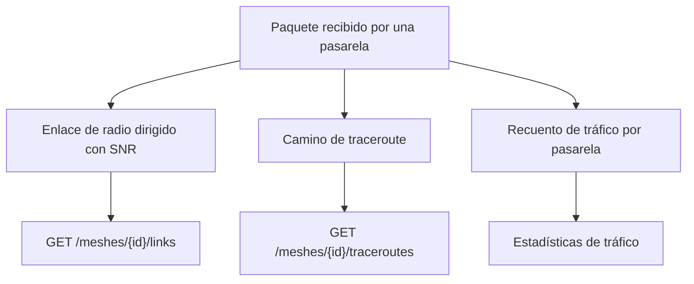

Además de los valores de los sensores, el descifrador registra cómo está armada la red de radio: qué nodos oyen a cuáles, el camino de cada traceroute y cuánto tráfico gestiona cada pasarela.

Un mismo paquete puede alimentar tres registros distintos. Cada uno responde a una pregunta diferente.

<Callout type="info" title="El tráfico va aparte de los datos de sensores">
Las estadísticas de tráfico cuentan paquetes. Un nodo puede meter mucho tráfico en la malla y no informar de ningún canal de sensor.
</Callout>

En una malla pública, los enlaces, los traceroutes y las estadísticas de tráfico se pueden leer sin credenciales.

## Enlaces de radio

`GET /meshes/{id}/links` devuelve saltos dirigidos. `from_node` transmitió. `to_node` midió el SNR. El mismo par oído en los dos sentidos son dos enlaces. Un enlace se guarda aparte por cada forma en que se observó:

| Método | Significado |
| --- | --- |
| `traceroute` | Un salto incluido en un traceroute |
| `neighborinfo` | Un informe de vecinos: el vecino transmitió y el nodo que informa lo oyó |
| `direct` | Un paquete que una pasarela recibió sin salto intermedio. Los enlaces directos se añaden una vez por hora. |

Cada fila trae `samples`, `snr_mean` (dB), `last_snr` (nulo si el paquete no traía la medida), `first_seen`, `last_seen`, los identificadores de dispositivo cuando esos nodos están registrados y `distance_km` cuando ambos tienen posición. Los valores de SNR que no encajan con un salto conocido del traceroute se descartan. El paquete se conserva.

`since` es `24h`, `7d` o `30d`. El valor por defecto es `7d`. Los enlaces que no se oyen en 30 días se borran.

## Traceroutes

`GET /meshes/{id}/traceroutes` devuelve los paquetes de traceroute, del más reciente al más antiguo. Cada traceroute se guarda una sola vez, aunque lo oigan varias pasarelas. Se conserva el camino más largo que se haya visto. `gateway_ids` enumera las pasarelas que lo oyeron.

`from_node` envió este paquete y `to_node` era su destino. En una respuesta (`request_id` informado), esos dos campos van al revés del traceroute original. `origin` lo inició y `target` es adonde iba. `towards` y `snr_towards` van del origen hacia el destino. `back` y `snr_back` vuelven. Una respuesta puede traer los dos sentidos. Una petición solo tiene los saltos dados hasta ese momento. El SNR está en dB y es nulo donde no se midió. `complete` es verdadero cuando `towards` llega al destino.

Los traceroutes se conservan 30 días. `limit` vale 50 por defecto y se detiene en 500. Pasa `before` con el `heard_at` de la última fila para leer la página siguiente.

## Tráfico

Se cuenta cada paquete que recibe una pasarela registrada, incluidos el texto, el encaminamiento y los paquetes que no se pudieron descifrar. Un paquete oído por varias pasarelas es un paquete y varias recepciones. Los nodos rechazados cuentan en los totales y no se listan como nodos.

- `GET /readings/meshes/{id}/stats` devuelve las cifras de la malla: solapamiento entre pasarelas, retransmisiones y actividad. Las retransmisiones llegan como el último byte del número de nodo, con los nodos registrados a los que ese byte podría corresponder.
- `GET /readings/devices/{uuid}/traffic` y `GET /readings/meshes/{id}/nodes/{node_id}/traffic` devuelven los tipos de paquete y el volumen de un solo nodo. Un `portnum` nulo es un paquete que no se pudo descifrar.

`range` es `1h`, `24h`, `7d` o `30d`. El valor por defecto es `24h`. Las cifras horarias empiezan en la hora en punto anterior o igual al inicio del rango. Los últimos minutos aún pueden crecer. La misma malla y el mismo rango se guardan en caché alrededor de un minuto.

Estas cifras describen la actividad de radio, no el catálogo de sensores.
