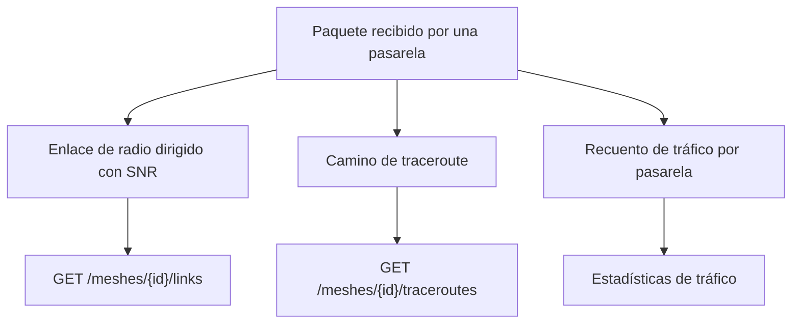

Además de los valores de los sensores, el servicio de descifrado registra la estructura de la red de radio: qué nodos reciben a cuáles, el camino de cada traceroute y el volumen de tráfico que gestiona cada pasarela.

Un mismo paquete puede contribuir a tres registros distintos. Cada uno responde a una pregunta diferente, y no son intercambiables.

<Callout type="info" title="El tráfico es independiente de los datos de sensores">
Las estadísticas de tráfico cuentan paquetes. Un nodo puede generar un tráfico considerable en la malla sin informar de ningún canal de sensor.
</Callout>

## Enlaces de radio

`GET /meshes/{id}/links` devuelve saltos dirigidos: `from_node` transmitió el paquete y `to_node` midió su SNR. Un enlace se registra por separado para cada método por el que se observó:

| Método | Significado |
| --- | --- |
| `traceroute` | Un salto incluido en un traceroute |
| `neighborinfo` | Un informe de vecinos |
| `direct` | Un paquete recibido directamente del emisor |

Cada registro almacena el número de muestras, la suma de los valores de SNR, el último SNR y los instantes de la primera y la última observación. El SNR se expresa en dB y es nulo cuando el paquete no incluía la medición. Los valores de SNR que exceden el camino conocido de un traceroute se ignoran en lugar de rechazar el paquete.

## Traceroutes

`GET /meshes/{id}/traceroutes` devuelve los paquetes de traceroute. Cada traceroute se almacena una sola vez, independientemente del número de pasarelas que lo recibieran. `from_node` envió el paquete y `to_node` era su destino. En una respuesta (`request_id` informado), estos dos campos aparecen invertidos respecto al sentido del traceroute original. `route` y `route_back` contienen números de nodo, y `snr_towards` y `snr_back` contienen los valores de SNR correspondientes. `gateway_ids` enumera las pasarelas que recibieron esta copia del paquete.

## Tráfico

Se contabiliza cada paquete recibido por una pasarela registrada.

- `GET /readings/meshes/{id}/stats` devuelve las estadísticas de la malla: solapamiento entre pasarelas, retransmisiones y actividad.
- `GET /readings/devices/{uuid}/traffic`, y el endpoint equivalente por número de nodo, devuelven los tipos de paquete y el volumen de un único nodo.

Estas estadísticas describen la actividad de radio, no el catálogo de sensores.
