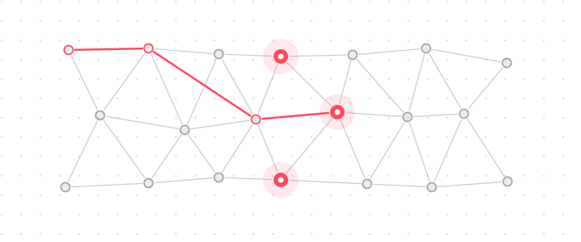
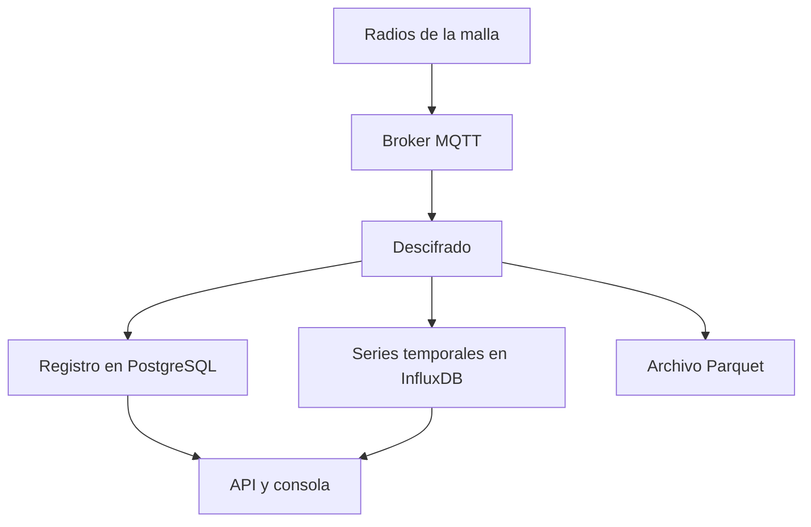

Mesh Things gestiona una malla LoRa de [Meshtastic](https://meshtastic.org/) como una flota de dispositivos registrados. Las pasarelas publican paquetes protobuf en un broker MQTT. La plataforma descifra esos paquetes con la clave de la malla, almacena las lecturas resultantes y permite consultarlas mediante una API HTTP y la consola.

{/* Las imágenes viven en content/docs/assets y se referencian con una ruta relativa a este fichero. Vite las empaqueta al compilar; ambos idiomas comparten el mismo fichero. */}

Cada etapa del proceso almacena un tipo de dato distinto. El bus de mensajes transporta los paquetes en bruto, PostgreSQL contiene el registro de dispositivos e InfluxDB contiene las mediciones.

## Usuarios previstos

- Propietarios que operan una o varias mallas y necesitan un registro duradero de los datos de sus sensores.
- Usuarios que necesitan recibir avisos cuando un nodo deja de transmitir, un sensor informa de un valor constante o un valor sale de su rango válido.
- Equipos que calculan canales adicionales a partir de las lecturas en bruto, con una calibración que puede cambiar con el tiempo.
- Operadores que importan tráfico desde un broker MQTT remoto o que publican un subconjunto de lecturas para terceros.
- Usuarios que requieren acceso de solo lectura a una malla pública.

## Procesamiento de paquetes

1. **Ingesta.** El tráfico del broker MQTT se copia en la plataforma como paquetes en bruto. El broker puede ser el de la propia instancia o un broker remoto registrado como [fuente](/sources).
2. **Descifrado.** El servicio de descifrado descifra cada paquete con la clave precompartida de la malla y lo convierte en datos estructurados. Se descartan los paquetes de pasarelas desconocidas y de nodos rechazados.
3. **Catalogación.** Cada paquete actualiza el registro: se crean o actualizan en PostgreSQL los dispositivos, las variantes de telemetría y los canales de medida.
4. **Almacenamiento.** Las lecturas descifradas se escriben en InfluxDB. Los dispositivos que lo activan se archivan además en ficheros Parquet por horas.
5. **Procesamiento.** Los detectores evalúan las lecturas entrantes, y los trabajos programados aplican plantillas y comprobaciones de completitud sobre el histórico almacenado.
6. **Acceso.** La API de registro gestiona cuentas, mallas, dispositivos y el catálogo. La API de lecturas sirve series, últimos valores, exportaciones y el archivo. La consola se apoya en ambas.

## Almacenamiento de datos

| Datos | Almacén |
| --- | --- |
| Cuentas, mallas, claves, dispositivos, catálogo, plantillas | PostgreSQL |
| Telemetría, posiciones, información de nodo, canales derivados, métricas de calidad, alarmas | InfluxDB |
| Eventos descifrados archivados, para los dispositivos que lo activan | Almacenamiento de objetos compatible con S3, en formato Parquet |

El contrato HTTP se publica como documento OpenAPI en `/schema` en el host de la API, con una interfaz Swagger interactiva. Esa referencia se mantiene por separado de esta guía.

## Páginas relacionadas

<Cards>
  <Card title="Conceptos" href="/concepts" description="Malla, pasarela, nodo y los dos significados de canal." />
  <Card title="Cuentas" href="/accounts" description="Alta, autenticación y acceso a la clave de la malla." />
  <Card title="Arquitectura" href="/architecture" description="Componentes de la plataforma y flujo de datos entre ellos." />
  <Card title="Almacenes de datos" href="/data" description="Contenido de PostgreSQL, InfluxDB y el archivo Parquet." />
</Cards>
