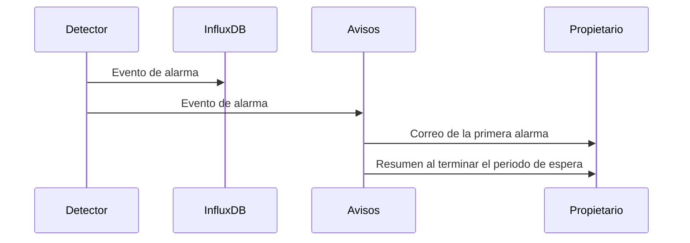

Los detectores disponibles se obtienen con `GET /detectors`. Un canal ejecuta los detectores de su lista `enabled_detectors`, o el valor por defecto del catálogo cuando ese campo es nulo. Una lista vacía desactiva la detección en el canal. La detección de ausencia es la excepción: se activa en el dispositivo, ya que un periodo sin transmisiones concierne a la radio y no a un campo concreto.

Los eventos de alarma y los avisos de alarma se gestionan por separado. Cada evento se almacena primero; los avisos por correo se envían después y de forma agrupada.

<Callout type="info" title="Detectores en flujo">
`flat_value`, `range` y `absence` evalúan las lecturas a medida que llegan. Solo están disponibles en las instancias que ofrecen procesamiento en flujo. Las comprobaciones de completitud y las plantillas se ejecutan como trabajos programados.
</Callout>

| Detector | Ámbito | Evaluación | Requisitos |
| --- | --- | --- | --- |
| `flat_value` | Canal | En flujo | Un intervalo de lectura. La ventana abarca aproximadamente tres horas de muestras. |
| `range` | Canal | En flujo | `valid_min` y `valid_max` en el canal, establecidos conjuntamente. |
| `absence` | Dispositivo | En flujo | `absence_detection_enabled` y `publish_interval_seconds`. |
| `completeness` | Canal | Programada | `reading_interval_seconds`. Genera una alarma cuando la proporción de datos es baja o un hueco es largo. |

Los eventos de alarma se almacenan en la medición `alarms`, etiquetados con el detector, la malla, el nodo, un canal opcional y `source` (`stream` o `batch`).

## Avisos por correo

La primera alarma de un dispositivo envía un correo al propietario de la malla de forma inmediata. Las alarmas posteriores del mismo dispositivo, con independencia del detector o del canal, se retienen durante `alarm_email_cooldown_seconds`. Al terminar ese periodo, un único correo de resumen enumera las alarmas retenidas. Un periodo de 0 envía un correo por cada alarma.

El propietario puede sustituir el valor por defecto de la instancia desde la página de perfil. Los correos incluyen enlaces a la consola. Los propietarios reciben además un recordatorio diario mientras haya alarmas activas.

## Vistas de la consola

**Automatización → Alarmas** configura qué condiciones se vigilan en cada medición. En la página del dispositivo, cada canal puede heredar, sustituir o desactivar esa configuración, y la detección de ausencia puede activarse para todo el dispositivo.
