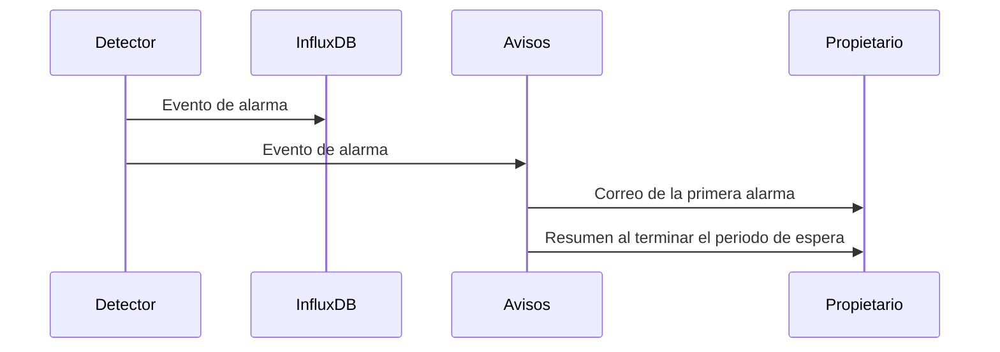

`GET /detectors` lista los detectores. Un canal ejecuta los de su lista `enabled_detectors`. Si ese campo es nulo, el canal usa el valor por defecto del catálogo. Una lista vacía apaga la detección en el canal. La ausencia es la excepción: se activa en el dispositivo, porque el silencio es de la radio, no de un campo.

Cada alarma se guarda primero. El correo va después, y casi siempre agrupado.

<Callout type="info" title="Detectores en flujo">
`flat_value`, `range` y `absence` se evalúan al llegar cada lectura. Solo existen en las instancias con procesamiento en flujo. La completitud se ejecuta de forma programada. Los pasos de plantilla por ventana también. Los pasos puntuales se ejecutan además con cada muestra.
</Callout>

| Detector | Ámbito | Evaluación | Requisitos |
| --- | --- | --- | --- |
| `flat_value` | Canal | En flujo | Ninguno. Salta cuando el mismo valor dura 12 horas y abarca al menos 3 lecturas. |
| `range` | Canal | En flujo | `valid_min` y `valid_max` en el canal, puestos o quitados a la vez. Salta tras 3 lecturas seguidas fuera del rango, o 2 si el intervalo de lectura es de 30 minutos o más. |
| `absence` | Dispositivo | En flujo | `absence_detection_enabled`, y `publish_interval_seconds` o el intervalo de lectura del dispositivo. Salta una vez, tras unos 3 intervalos perdidos (como mínimo 60 segundos). |
| `completeness` | Canal | Programada | `reading_interval_seconds`. En las últimas 24 horas, salta si llegó menos del 80 % de las lecturas esperadas (y se esperaban al menos 24), o si un hueco dura más de 6 intervalos y 30 minutos. |

Las 12 horas, el 80 %, las 24 horas y los límites de hueco son los valores por defecto. Quien opera la instancia puede cambiarlos.

Los eventos de alarma van a la medición `alarms`. Las etiquetas son el detector, la malla, el nodo, un canal opcional y `source` (`stream` o `batch`).

## Avisos por correo

La primera alarma de un dispositivo se envía al momento al propietario de la malla. Las siguientes de ese dispositivo, de cualquier detector o canal, esperan `alarm_email_cooldown_seconds`. Al terminar la espera, un solo resumen las enumera. Un periodo de 0 envía un correo por cada alarma. El valor por defecto de la instancia es 1 hora. El propietario puede cambiarlo en la página de perfil.

La ausencia no espera. Un dispositivo en silencio se avisa al momento, y como mucho una vez al día para ese dispositivo.

Una condición que sigue activa se recuerda aproximadamente una vez al día (las alarmas `repeat`). La instancia puede poner ese recordatorio a 0 y no enviar ninguno. Las alarmas marcadas `replay`, de un histórico reprocesado, no se envían nunca por correo.

Los correos enlazan con la consola.

## Vistas de la consola

**Automatización → Alarmas** elige qué condiciones se vigilan en cada medición. En la página del dispositivo, cada canal puede heredar esa elección, sustituirla o apagarla. La ausencia se puede activar para todo el dispositivo.
