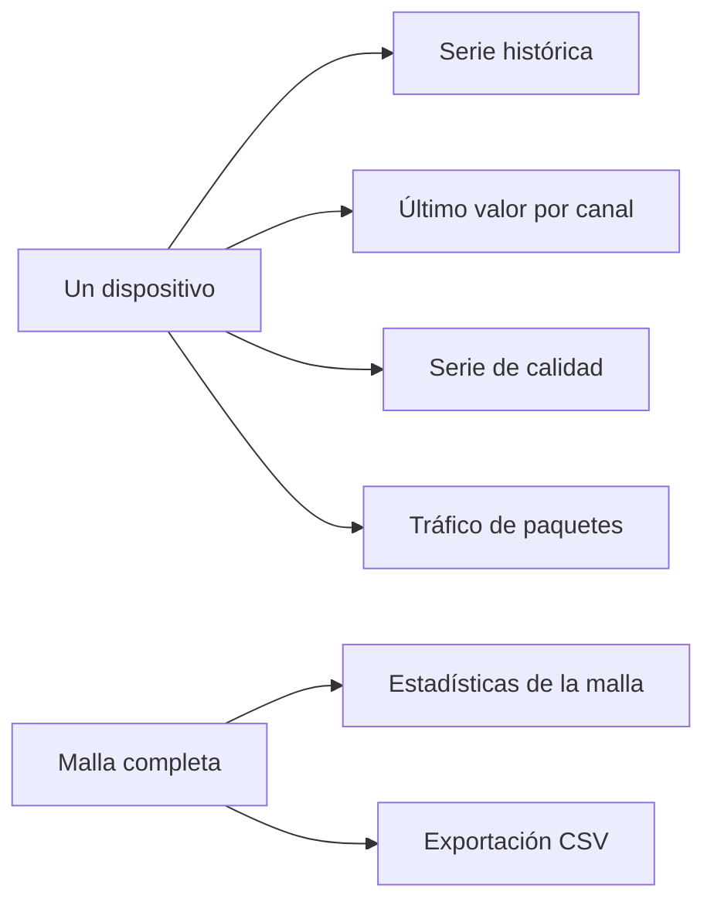

Las lecturas se almacenan en InfluxDB. La API de lecturas nunca devuelve la PSK de la malla. Un dispositivo puede consultarse por su identificador de registro, o por el identificador de la malla junto con el número de nodo de Meshtastic.

La API de lecturas ofrece varios endpoints sobre el mismo almacén. El endpoint adecuado depende de los datos que se necesitan.

<Callout type="info" title="Una exportación a la vez">
Una nueva exportación solicitada mientras otra se está preparando devuelve 429. El enlace de descarga es válido durante 24 horas; transcurrido ese plazo, el fichero se elimina y la exportación debe solicitarse de nuevo.
</Callout>

| Datos | Endpoint |
| --- | --- |
| Muestras históricas | `GET /readings/devices/{uuid}` o `GET /readings/meshes/{mesh}/nodes/{node}` |
| Último valor por canal | `.../latest` |
| Serie de calidad | `.../quality` |
| Tráfico de paquetes de un nodo | `.../traffic` |
| Tráfico de toda la malla | `GET /readings/meshes/{mesh}/stats` |

Una serie se consulta con los parámetros `channel`, `start`, `stop`, `window` y `agg`. Por defecto, la página del dispositivo muestra las últimas 24 horas, agregadas como media en ventanas de una hora, y selecciona `environment_metrics.temperature` cuando ese canal existe.

`start` y `stop` admiten un instante absoluto o un valor relativo como `-24h`. `window` establece el tamaño de cada ventana de agregación. `agg` establece la función de agregación aplicada en cada ventana: `mean` o cualquiera de las demás funciones que indica la API.

Los últimos valores aparecen como tarjetas en la parte superior de la página del dispositivo, con el valor, la unidad, el tipo de magnitud y la hora. Cuando no existe ningún valor en el periodo consultado, la tarjeta muestra un estado vacío en lugar de cero.

## Descargas CSV

Los propietarios de mallas y los superusuarios pueden exportar lecturas en CSV. La página del dispositivo ofrece **Descargar CSV** para un único dispositivo. **Datos → Descargas CSV** (`/console/csv-downloads`) abarca una malla completa o una selección de sus dispositivos.

Cada exportación es un fichero ZIP que se prepara en segundo plano.

| Límite | Valor |
| --- | --- |
| Rango máximo | 366 días |
| Exportaciones en preparación | Una cada vez. Una segunda solicitud devuelve 429. |
| Validez del enlace | 24 horas. Se envía un correo cuando la exportación está lista. |
| Historial de exportaciones | 30 días, para poder solicitar de nuevo una exportación |

Los estados de una exportación son `queued`, `running` (con el número de días procesados sobre el total), `ready` (con una URL firmada válida hasta `expires_at`), `failed` (con un mensaje de error) y `expired` (el fichero se ha eliminado y debe solicitarse de nuevo).

Las exportaciones Parquet del archivo utilizan el mismo mecanismo con `format: parquet`. Véase [Archivo](/docs/archive).

## Límites de uso

Las peticiones a la API de lecturas están limitadas por propietario. Los superusuarios no están sujetos a estos límites.
