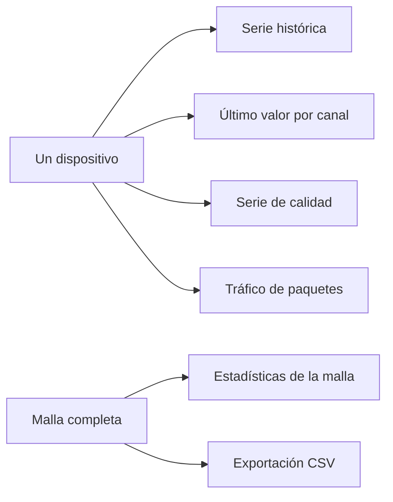

Las lecturas se guardan en InfluxDB. La API de lecturas nunca devuelve la clave de la malla. Un dispositivo se consulta por su identificador de registro, o por el identificador de la malla junto con el número de nodo de Meshtastic.

Cada endpoint de abajo lee el mismo almacén. Elige el que corresponde a los datos que necesitas.

<Callout type="info" title="Una exportación a la vez">
Una exportación nueva, pedida mientras otra se está preparando, devuelve 429. El enlace de descarga vale 24 horas. Después se borra el fichero y hay que pedir la exportación otra vez.
</Callout>

| Datos | Endpoint |
| --- | --- |
| Muestras históricas | `GET /readings/devices/{uuid}` o `GET /readings/meshes/{mesh}/nodes/{node}` |
| Último valor por canal | `.../latest` |
| Serie de calidad | `.../quality` |
| Tráfico de paquetes de un nodo | `.../traffic` |
| Tráfico de toda la malla | `GET /readings/meshes/{mesh}/stats` |

Una serie necesita `channel` o `payload_kind`, más `start` y `stop`. `window` y `agg` son opcionales. `channel` es una serie, por ejemplo `environment_metrics.temperature`. `payload_kind` es una familia, por ejemplo `telemetry:environment_metrics`, y devuelve todos sus canales. Si van los dos, manda `channel`.

`start` y `stop` admiten un instante absoluto o un valor relativo como `-24h`. En la API, `start` vale `-1h` y `stop` vale `now()` si no los indicas. `window` agrupa las muestras en intervalos, por ejemplo `1h`. No se aplica hasta que lo indicas. `agg` es la función dentro de cada intervalo: `mean`, `max`, `min`, `last`, `first`, `sum` o `count`. Solo cuenta cuando hay `window`, y por defecto es `mean`.

La página del dispositivo abre las últimas 24 horas, con la media en ventanas de una hora.

Los últimos valores son tarjetas arriba de la página del dispositivo: valor, unidad, tipo de magnitud y hora. La API mira 30 días atrás salvo que indiques `lookback`. Un canal sin muestra en ese periodo muestra un estado vacío, no un cero.

## Descargas CSV

Los propietarios de mallas y los superusuarios pueden exportar lecturas en CSV. La página del dispositivo tiene **Descargar CSV** para un dispositivo. **Datos → Descargas CSV** (`/console/csv-downloads`) cubre una malla entera o una selección de sus dispositivos.

Cada exportación es un ZIP que se prepara en segundo plano.

| Límite | Valor |
| --- | --- |
| Rango máximo | 366 días por defecto |
| Exportaciones en preparación | Una cada vez. Una segunda solicitud devuelve 429. |
| Solicitudes de exportación | 30 por hora y propietario, además del límite de lecturas de abajo |
| Validez del enlace | 24 horas. Si la instancia envía correo, el propietario recibe un aviso cuando la exportación está lista o ha fallado. |
| Historial de exportaciones | 30 días, para poder pedir de nuevo una exportación |

Una exportación pasa por `queued`, `running` (días procesados sobre el total), `ready` (una URL firmada válida hasta `expires_at`), `failed` (un mensaje de error) y `expired` (el fichero ya no está; hay que pedirla otra vez).

Las exportaciones Parquet del archivo usan el mismo camino con `format: parquet`. Véase [Archivo](/archive).

## Límites de uso

Las peticiones de lecturas se limitan por propietario, 120 por minuto por defecto. Las lecturas anónimas de una malla pública se limitan a 60 por minuto. Los superusuarios no tienen límite.
