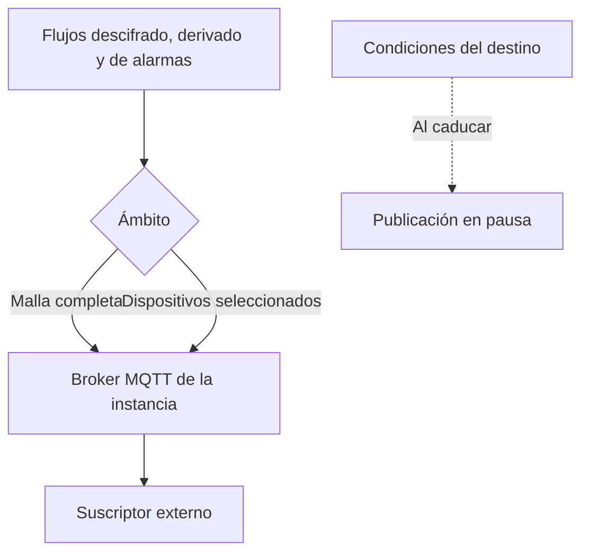

Un destino exporta datos, mientras que una fuente los importa. Un operador publica lecturas en el broker MQTT de la instancia, y un consumidor designado por el operador se suscribe con su propio usuario y contraseña. El broker almacena la contraseña como hash, y la API solo la muestra una vez, cuando se establece o se vuelve a emitir.

El operador selecciona los flujos y los dispositivos. El consumidor nunca tiene acceso a la clave de la malla.

<Callout type="warn" title="La contraseña se muestra una sola vez">
Emitir una nueva contraseña desconecta a los consumidores conectados en ese momento. Eliminar el destino revoca sus credenciales. No es posible eliminar un destino mientras tenga mallas o dispositivos asociados.
</Callout>

Los destinos solo están disponibles en las instancias cuyo broker los admite. En el resto de instancias, todos los endpoints de destinos devuelven 404 y la consola indica que la función no está disponible.

Solo los operadores y los superusuarios gestionan destinos, y un operador solo puede consultar los destinos que ha creado. La página se encuentra en **Datos → Destinos** (`/console/sinks`).

## Flujos publicados

`streams` es un subconjunto no vacío de `decoded`, `derived` y `alarms`, almacenado en ese orden.

Los datos se publican desde:

- una malla completa, incluidos los nodos que se añadan después, o
- dispositivos seleccionados individualmente

Al seleccionar la malla, se desactivan las casillas de los dispositivos, que se marcan como incluidos con la malla. Al quitar la selección de la malla, se restauran los dispositivos seleccionados anteriormente, y son esos dispositivos los que se almacenan. Al editar, cada lista enviada sustituye a la lista actual. Las credenciales no cambian al editar.

El usuario debe tener permiso de edición sobre la malla o el dispositivo, y el propietario de la malla debe ser operador. Un superusuario puede asociar destinos a las mallas de un operador.

## Credenciales

La creación de un destino y **Emitir una nueva contraseña** devuelven la contraseña una sola vez, junto con la dirección del broker, el usuario, el filtro de topic y un comando `mosquitto_sub` que mantiene una sesión persistente. Emitir una nueva contraseña desconecta a los consumidores actuales. Eliminar el destino revoca sus credenciales.

No es posible eliminar un destino mientras tenga mallas o dispositivos asociados. En ese caso, la API devuelve 409, y es necesario editar el destino para retirarlos previamente.

## Condiciones

Cada creación de un destino acepta las condiciones de destino vigentes. El operador es responsable de los datos que publica el destino y de las partes que reciben las credenciales. Si la aceptación caduca, se informa `paused_at`: no se publica ningún dato y se rechazan las conexiones de los consumidores hasta que el creador renueva las condiciones.

La lista muestra si cada destino está publicando o en pausa, el número de mallas y dispositivos que abarca y el número de consumidores conectados en ese momento. Cuando el broker no responde, el número de conexiones se muestra como un guion.
