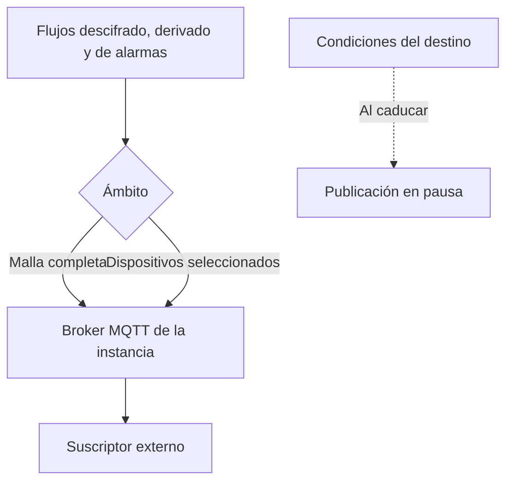

Un destino exporta datos. Una fuente los importa. Un operador publica lecturas en el broker MQTT de la instancia. Un consumidor que elige el operador se suscribe con su propio usuario y contraseña. El broker guarda la contraseña como hash. La API la muestra una vez, al establecerla o al emitirla de nuevo.

El operador elige los flujos y los dispositivos. El consumidor nunca recibe la clave de la malla.

<Callout type="warn" title="La contraseña se muestra una sola vez">
Emitir una contraseña nueva desconecta a los consumidores que están conectados. Eliminar el destino revoca sus credenciales. No se puede eliminar un destino mientras tenga mallas o dispositivos asociados.
</Callout>

Los destinos solo existen en las instancias cuyo broker los admite. En las demás, todos los endpoints de destinos devuelven 404 y la consola indica que la función no está disponible.

Solo los operadores y los superusuarios gestionan destinos. Un operador solo ve los destinos que ha creado. La página es **Datos → Destinos** (`/console/sinks`).

## Flujos publicados

`streams` es un subconjunto no vacío de `decoded`, `derived` y `alarms`, almacenado en ese orden.

Las lecturas se publican desde:

- una malla completa, incluidos los nodos que se añadan después, o
- dispositivos elegidos uno a uno

Al elegir la malla se desactivan las casillas de los dispositivos. Esos dispositivos quedan marcados como incluidos con la malla. Al quitar la malla se restauran los dispositivos que estaban seleccionados antes, y son esos los que se guardan. Al editar, cada lista que envías sustituye a la lista actual. Las credenciales no cambian al editar.

Necesitas permiso de edición sobre la malla o el dispositivo, y el propietario de la malla debe ser operador. Un superusuario puede asociar destinos a las mallas de un operador.

## Credenciales

Crear un destino y **Emitir una nueva contraseña** devuelven la contraseña una sola vez, con la dirección del broker, el usuario, el filtro de topic y un comando `mosquitto_sub` que mantiene una sesión persistente. La sesión encola los mensajes mientras ese cliente está desconectado. La cola solo se conserva para un cliente que ya se haya conectado. Se descarta al pasar el límite de desconexión de la instancia (24 horas, salvo que se configure otro) o al superar el límite de cola (10.000 mensajes, salvo que se configure otro). Un cliente que sigue conectado y supera esa cola se desconecta. Emitir una contraseña nueva desconecta a los consumidores actuales. Si el broker no puede guardar la contraseña nueva, la API devuelve 502 y se mantiene la anterior. Eliminar el destino revoca sus credenciales.

No se puede eliminar un destino mientras tenga mallas o dispositivos asociados. La API devuelve 409. Edita el destino y retíralos antes.

## Condiciones

Cada creación de un destino acepta las condiciones de destino vigentes. El operador responde de los datos que publica el destino y de quién recibe las credenciales. Si la aceptación caduca, se establece `paused_at`: no se publica nada y se rechazan las conexiones de los consumidores, hasta que quien creó el destino renueva las condiciones. La renovación usa las mismas credenciales. Si el broker no puede reanudar el destino, la renovación devuelve 502 y las condiciones quedan como estaban.

La lista muestra si cada destino está publicando o en pausa, cuántas mallas y dispositivos abarca y cuántos consumidores hay conectados. Si el broker no responde, el número de conexiones es un guion.
